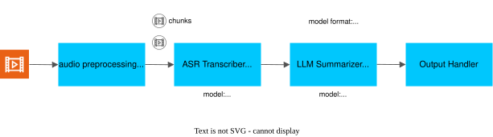
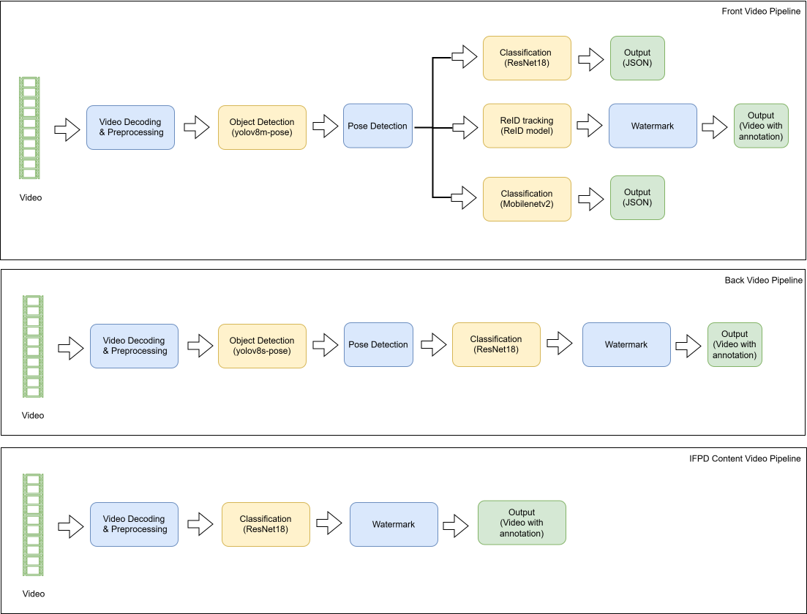
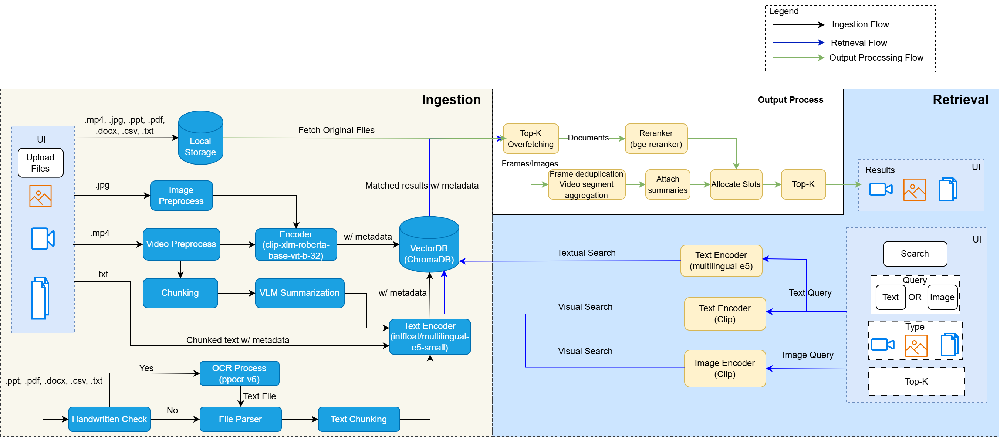

# Smart Classroom

The **Smart Classroom** project is a modular, extensible framework designed to process and summarize educational content using advanced AI models for the Windows OS. It supports transcription, summarization, mindmap generation, future capabilities like video understanding, multimodal content search, and real-time video analytics.

## Main Features

The main features are as follows:

### Audio Pipeline

- Audio transcription with ASR models (e.g., Whisper, Paraformer)
- Speaker diarization using Pyannote Audio models (optional)
- Summarization using powerful LLMs (e.g., Qwen, LLaMA)
- MindMap generation using Mermaid.js for visual diagram rendering of the summary
- Content segmentation for automatic topic extraction from transcripts

### Video Analytics Pipeline

- Real-time video analysis across three concurrent camera streams (front, back, content)
- Person detection and pose estimation using YOLO models with keypoint skeleton tracking
- Person re-identification for tracking individual students across frames
- Classroom statistics including student count, stand-up events, and hand-raise events

### Content Search

- Multimodal semantic search across videos, images, and documents
- AI-driven video summarization using Vision Language Models (VLM)
- Document text extraction with OCR support (PaddleOCR)
- RAG-based Question & Answer over uploaded educational materials
- Vector-based retrieval using ChromaDB with CLIP and mE5 embeddings

### Report Generator

- Report generation triggered via report API after session outputs are ready
- Session-based inputs from summary, mindmap, and topic segmentation outputs
- Field-selectable template report generation with streaming output
- Report retrieval and export in Markdown, DOCX, and PDF formats
- Fast reselect flow to update included fields without rerunning full LLM generation

## Architecture

- Plug-and-play architecture for integrating new ASR, LLM, and video analytics models
- API-first design ready for frontend integration

## Get Started

To see the system requirements and other installations, see the following guides:

- [System Requirements](../docs/user-guide/get-started/system-requirements.md): Check the hardware and software requirements for deploying the application.
- [Get Started](../docs/user-guide/get-started.md): Follow step-by-step instructions to set up the application.
- [Application Flow](../docs/user-guide/application-flow.md): Check the flow of application.
- [Speaker Diarization Setup](../docs/user-guide/advanced-setup-guide.md#f-speaker-diarization-setup-optional): Optional one-time Hugging Face token setup required to enable speaker diarization.

## How It Works

The architecture follows a modular, dual-pipeline design for comprehensive classroom analysis.

The **audio pipeline** begins with audio preprocessing, where FFmpeg chunks input audio into smaller segments for optimal handling. These segments are processed by an **ASR transcriber** (e.g., Whisper or Paraformer) to convert speech into text. An **LLM summariser** (Qwen), optimised through OpenVINO™, generates concise summaries delivered via the output handler.

The **video analytics pipeline** processes up to three concurrent camera streams (front, back, content) through DL Streamer-based processing graphs. Each stream passes through **YOLO-based person detection and pose estimation**, followed by **posture classification** (sit/stand, hand-raise) and **multi-model classification** (ResNet-18, MobileNet-V2, Person-ReID). All models run on OpenVINO™ with NPU by default. Processed video is streamed via a **MediaMTX RTSP server**, and per-frame metadata is aggregated into classroom engagement statistics.

The **content search pipeline** handles multimodal content ingestion and retrieval. Uploaded files (videos, documents, images) are processed through format-specific extractors: videos are split into time-based chunks and summarized by a **VLM** (Qwen3-VL); documents undergo text extraction with optional OCR (PaddleOCR) and semantic chunking; images are embedded directly via **CLIP**. All content is indexed into **ChromaDB** with dual embeddings (CLIP for visual, mE5 for text). At query time, a **cross-encoder reranker** (BGE-reranker) scores document results, and **Reciprocal Rank Fusion (RRF)** merges results across modalities for balanced retrieval. A RAG-based Q&A layer generates grounded answers from the retrieved context.

<p align="center">
  
</p>
<p align="center">
  
</p>
<p align="center">
  
</p>

For more information see [How it works](../docs/user-guide/how-it-works.md)

## Learn More

- [Release Notes](../docs/user-guide/release-notes.md)

## GPU Queue Priority

OpenCL (Open Computing Language) is an open
Khronos Group standard for running compute workloads on GPUs and other accelerators.
Work is submitted to the device through command queues, and the OpenVINO GPU plugin
uses OpenCL to execute models on Intel GPUs. OpenCL lets each queue carry a priority
hint, so the GPU driver can schedule higher-priority work first when several
workloads compete for the GPU.

Set `models.gpu_queue_priority` in [config.yaml](./config.yaml) to control the
OpenVINO GPU queue priority used by Smart Classroom services. It maps to the
OpenVINO GPU plugin property `GPU_QUEUE_PRIORITY` (`ov::intel_gpu::hint::queue_priority`),
which sets the OpenCL queue priority hint defined in the
[OpenCL 2.1 extensions specification](https://www.khronos.org/registry/OpenCL/specs/opencl-2.1-extensions.pdf).

```yaml
models:
  gpu_queue_priority: LOW # LOW, MEDIUM, or HIGH
```

| Value    | OpenCL priority hint           | Notes                                              |
|----------|--------------------------------|----------------------------------------------------|
| `LOW`    | `CL_QUEUE_PRIORITY_LOW_KHR`    | Smart Classroom default; yields GPU to other apps  |
| `MEDIUM` | `CL_QUEUE_PRIORITY_MED_KHR`    | OpenVINO plugin default                            |
| `HIGH`   | `CL_QUEUE_PRIORITY_HIGH_KHR`   | Favors Smart Classroom when sharing the GPU        |

- Values are case-insensitive; missing or invalid values fall back to `LOW`.
- The setting applies only to services running OpenVINO on a GPU device
  (for example the VLM serving component); CPU and NPU workloads are unaffected.
- Restart Smart Classroom after changing the value.
- The priority is a hint to the driver; its effect depends on GPU driver support
  and is most noticeable when multiple applications share the GPU.
