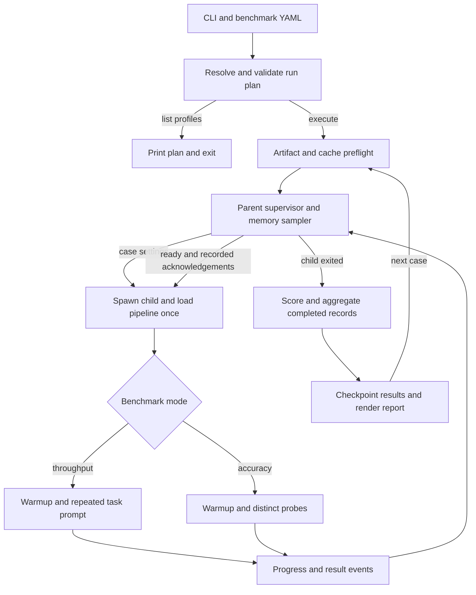

# Context Bench Design

**Status:** Implementation design for `smart-classroom/components/context_bench/`.

Companion document: [vlm-llm-serving-design.md](vlm-llm-serving-design.md).

## 1. Purpose and Reference Baseline

### Scope

Implement `context_bench` as an offline, text-only OpenVINO LLM benchmarking tool. It answers whether a model can process a specified context within configured memory budgets, which runtime profile provides the best measured latency, and, optionally, how that profile affects retrieval accuracy and generation fidelity. It must not load the classroom application, start services, modify application configuration or automatically select production defaults. It benchmarks individual model calls; it does not replace the [workflow-stage instrumentation](vlm-llm-serving-design.md#7-processing-time-statistics) or certify image handling and tool calling.

| Mode | Work performed | What the result establishes |
| --- | --- | --- |
| Plan (`--list-profiles`) | Resolve configuration, filters, cases and probe counts without inference | The requested matrix is syntactically valid, not that artifacts/runtime/memory are sufficient. |
| Throughput (default) | Repeat one task prompt per case after warmup | Measured execution cost and context feasibility under the recorded budgets; no semantic-quality verdict. |
| Accuracy (`--accuracy`) | Run distinct retrieval/generation probes with per-probe decode budgets | Retrieval correctness and fidelity relative to a baseline, alongside probe timings; not a repeated-prompt throughput comparison. |

### Reference Sources

Porting references are pinned to commit `8e73a032443f8be6d0cd273c353d79c94c0a7c7a`: [source](https://github.com/tingjiec/edge-ai-suites/tree/8e73a032443f8be6d0cd273c353d79c94c0a7c7a/education-ai-suite/smart-classroom/components/llm/context_bench), [design analysis](https://github.com/tingjiec/edge-ai-suites/blob/8e73a032443f8be6d0cd273c353d79c94c0a7c7a/education-ai-suite/smart-classroom/docs/dev-guide/context-bench/context_bench_design.md), and [usage guide](https://github.com/tingjiec/edge-ai-suites/blob/8e73a032443f8be6d0cd273c353d79c94c0a7c7a/education-ai-suite/smart-classroom/docs/dev-guide/context-bench/context_bench_guide.md). Use the pinned code/YAML to resolve stale reference prose; historical timings are not qualification results for this port.

The source URL intentionally retains the upstream directory layout. Local package paths and commands below use the new location; the module responsibilities remain unchanged.

### Required Porting Changes

Retain the reference's benchmark methods. The following are deliberate porting changes, not existing upstream features:

| Area | Reference behavior | Required port behavior |
| --- | --- | --- |
| Planning and validation | Benchmark-specific settings with some permissive/defaulted fields | Validate the resolved schema and overrides; keep planning independent of inference imports and distinguish unresolved artifact checks (Section 3). |
| Artifact access | Tokenizer remote-code trust and in-place DFlash metadata repair are possible | Local-only tokenizer loading, no remote code, and explicit preparation of separate derived artifacts (Section 4). |
| Trial supervision | One-way child events and parent sampling windows | Add ready/recorded acknowledgements, per-iteration phase resets and confirmed cleanup before the next case (Section 5). |
| Measurement validity | Some unavailable metrics become zero; GPU telemetry is required even for CPU cases | Preserve nulls and timing provenance; apply device-appropriate budget checks (Sections 7 and 8). |
| Cache sizing | Target-context estimate with empirical speculative headroom | Include qualified decode/draft reservations; reject infeasible or unknown `auto` sizing instead of silently changing the pool/backend (Section 8). |
| Evidence and privacy | Text report, transient detailed records and printed answer excerpts | Versioned JSON plus text report, atomic checkpoints and opt-in synthetic answer persistence via `record_text` (Section 9). |
| Completion and CLI status | Partial coverage is not a separate status; case failure need not yield a nonzero process exit | Explicit partial coverage and nonzero failure exits, propagated by PowerShell (Section 9). |

Capacity-search/bisection, synthetic dry-run PASS results, automatic production tuning and new benchmark service/UI endpoints are outside scope.

## 2. Modules and Ownership

### Execution Units

| Term | Definition |
| --- | --- |
| Profile | Named OpenVINO, scheduler and optional speculative settings. A profile describes what to measure, not a performance recommendation. |
| Throughput case | One `(model, precision, device, context, task, profile)` combination in a fresh child process. |
| Accuracy case | One `(model, precision, device, context, profile)` combination whose child executes a deterministic probe set. |
| Iteration | One generation call, marked warmup or measured. Throughput iterations reuse the same final prompt and loaded pipeline. |
| Probe | One accuracy task/sample/depth combination with its own prompt, truth and output ceiling. It is not multiplied by `benchmark.iterations`. |

### Module Boundaries

Keep all benchmark modules, model-specific YAML and PowerShell launchers in `smart-classroom/components/context_bench/`; tests remain in `smart-classroom/components/tests/`. Use `components.context_bench` for absolute imports and module entry points, or package-relative imports internally. Keep inference imports lazy and the package initializer lightweight so planning and pure tests need no OpenVINO or model files.

When adapting the reference, update package imports, test imports, launcher commands and path-derived defaults together. From a module in this package, the Smart Classroom root is `Path(__file__).resolve().parents[2]`; from a colocated PowerShell launcher it is two directories above `$PSScriptRoot`. Resolve the default `config_qwen3.6_35b.yaml` beside the module, not from the caller's directory. Keep the backend environment at the root's existing sibling `smartclassroom/`; moving this package must not change model, cache or result locations.

| Module | Responsibility and implementation entry points |
| --- | --- |
| `benchmark.py` | CLI/config validation (`_parse_args`, `_load_settings`, `_resolve_profiles`), case planning, IR/cache preflight, sequential subprocess supervision, memory sampling, status evaluation, baseline matching and `write_report`. Own all run-level state and output files. |
| `trial_runner.py` | `run_case` loads once, runs throughput iterations or accuracy probes, emits progress/results, and exits the child. Keep `_load_pipeline`, `prepare_pipeline_input`, `generation_config`, `read_perf_metrics`, `validate_mtp` and error classification independently testable. |
| `context_builder.py` | Render native chat templates, size synthetic transcript prompts, place accuracy inserts and count the actual inference input. Keep prompt construction outside measured generation. |
| `metrics.py` | Build iteration records, normalize units, compute throughput/speculative statistics and aggregate measured iterations. No runtime loading, report I/O or scoring dependencies. |
| `tasks.py` | Define `ProbeSpec`, task registry, deterministic planted values, questions and per-probe output budgets. |
| `scoring.py` | Pure scoring functions for retrieval, lexical overlap and token divergence; no model inference. |
| `accuracy.py` | Build probe sets, dispatch scoring, group results and pair generated answers with the selected baseline. Score in the parent after child exit, outside resource sampling. |
| `wwb_adapter.py` | Optional, version-qualified who_what_benchmark semantic-similarity adapter. Missing package/model or unsupported result shape makes only similarity unavailable. |
| `dflash_draft_head.py` | Optional explicit preparation utility for a derived draft with its own quantized output head. Never run it implicitly inside a timed benchmark or overwrite serving artifacts. |
| Model-specific YAML and PowerShell launchers | Keep benchmark settings separate from application YAML. Colocate `run_benchmark.ps1` and `setup_env.ps1` with the package; forward arguments and Python exit status. Setup installs reviewed pinned dependencies explicitly, never during planning/trials or by weakening TLS/execution policy. |

### Control Flow



Run cases serially; profiles never share a live pipeline. Detailed synchronization and cleanup rules are in Section 5, and scoring boundaries in Section 6.

## 3. Configuration and CLI Contract

### Resolution and Schema

Load benchmark YAML with a safe parser into plain mappings, apply CLI overrides, validate, and freeze the settings before creating any child. Do not import an application configuration singleton to parse benchmark YAML. Precedence is **CLI override > selected benchmark YAML > documented tool default**. Resolve a relative `--config` against the caller's directory before the launcher changes to the Smart Classroom root; resolve model/cache/output paths from that root. Never write resolved values back to YAML.

| Section/key | Type and resolution rules |
| --- | --- |
| `model` | Required mapping: `provider: openvino`, non-empty `device`, `weight_format`, `models_base_path`; optional `model_dirs` mapping from benchmark model name to local IR directory. Support CPU/GPU device selectors, not NPU in this design. |
| `benchmark.models` | Required non-empty list of unique model names. These are benchmark keys, not necessarily Hub IDs. Resolve through `model_dirs` first; otherwise use `<models_base_path>/<provider>/<name with / replaced by _>_<weight_format>`. |
| `benchmark.context_tokens` | Required non-empty list of non-negative integers, sorted and deduplicated. Positive values are the total rendered input-token target, not transcript-only length. Zero means a standalone task prompt of its natural length. |
| `benchmark.output_tokens`, `warmup`, `iterations` | Required integers: output ceiling at least 2, warmup at least 0, measured iterations at least 1. Reject booleans as integers. Preserve the reference configurations' one warmup and three measured iterations; label zero-warmup/single-iteration runs as smoke tests. |
| `benchmark.throughput_task` | One task name or non-empty list; default `summary_2s`. Accept `summary_2s`, `classroom_summary`, `code`, `math`, `chat`; preserve order and deduplicate. |
| `benchmark.iteration_gap_sec` | Finite non-negative number, default 0. Intentional idle before each measured generation, excluded from generation time and the measured memory window. Report it as burst versus sustained workload metadata. |
| `benchmark.timeout_sec` | Required finite positive progress timeout, not a total case timeout. The pinned model configurations set 5400 seconds; this is not a universal TTFT requirement. Reject a gap greater than or equal to this timeout. |
| `benchmark.max_system_memory_pct` | Finite percentage in `(0, 100]`, tool default 80; the pinned configurations explicitly use 100. This is an evaluation budget, not an OS memory limit. |
| `benchmark.gpu_memory_budget_gb` | Required finite positive number for GPU runs, in GiB despite the legacy suffix. Operator-supplied platform budget; never derive a pass threshold from the driver's advertised total. CPU-only runs do not require GPU telemetry or enforce this budget. |
| `benchmark.cache_dir`, `output_dir` | Optional compiled-blob cache directory, default null; required output base directory. A cache must not enable prompt-prefix reuse. Record whether compiled artifacts were already cached. |
| `profiles` | Required non-empty list; each entry accepts only `name`, `ov`, `scheduler`, `mtp`, `dflash`. Names are unique non-empty strings; `ov` and `scheduler` are mappings. Reject misplaced `cache_size` at profile level. |
| `profile.ov` | OpenVINO/GenAI property mapping, preserved without speculative settings leaking into plugin properties. Unknown runtime properties produce `unsupported`, not silent removal. |
| `profile.scheduler` | Absent/empty selects stateful generation; a non-empty resolved mapping selects paged/continuous-batching generation. Every paged profile, including CLI overrides, requires positive integer `max_num_batched_tokens`, `max_num_seqs`, and boolean `enable_prefix_caching: false`. |
| `profile.mtp` | Mapping with only `enabled`, `num_assistant_tokens`, `device`; a non-empty mapping implies enabled unless explicitly false. Preserve boolean shorthand only when an enabled profile receives its candidate count from the CLI. |
| `profile.dflash` | Mapping with only `enabled`, `model`, `num_assistant_tokens`, `device`; `model` is a required local draft IR directory when enabled. A profile cannot contain both `mtp` and `dflash`. |
| `accuracy` | Read only with `--accuracy`; accept `suites`, `baseline_profile`, integer `seed`, optional `embedding_model`, and the `retrieval`/`generation` mappings described in Section 6. Require an included baseline profile for generation-fidelity comparisons. |
| `speculative_reference` | Optional display-only metadata: `source`, positive `num_assistant_tokens`, and per-task `dataset`, positive `acceptance_length`, `speedup`, optional `throughput`. Published numbers never affect status or ranking. |
| `benchmark.record_text` | **Integration addition**, boolean, default false. Opt-in persistence of synthetic generated answers for offline rescoring/fork inspection; never enable for private classroom material. Scores and timings are retained regardless. |

### Overrides and Speculative Profiles

Reject unknown benchmark/model keys and task-option keys, non-finite numbers, malformed mappings and wrong scalar types. `--pipeline-config KEY=VALUE` merges string values into each selected profile's `ov`; `--scheduler-config KEY=VALUE` converts recognized boolean/numeric scalar values. `KEY=` removes a property. Validate after overrides: removing a required property is an error, not permission to restore it silently. Warn when an override changes the pipeline mode.

Normalize either speculative section to `{enabled, strategy, model, num_assistant_tokens, device}` inside the resolved profile, retaining the reference's internal `mtp` field name for the port. Disabled means `enabled: false` and null remaining fields; enabled `strategy` is `mtp` or `dflash`. `--mtp-tokens K` and its alias `--assistant-tokens K` change only already-enabled profiles, including DFlash, and must leave plain baselines plain. Benchmark profile settings are deliberately separate from the production `models.text_gen.speculative` policy: a requested accelerated case either runs that mechanism or reports failure, **never falls back to plain and keeps the accelerated label**.

### Example Configuration

The following parser/plan fixture uses two profiles, a stock draft, sustained load (zero gap), an 80% RAM budget and reduced accuracy suites without semantic similarity. Paths identify prepared artifacts; the 59 GiB GPU budget is machine-specific. Section 10 lists the full reference matrices. These example settings are not performance results.

```yaml
model:
  provider: openvino
  device: GPU
  weight_format: int4
  models_base_path: models
  model_dirs:
    Qwen3.6-35B-A3B: models/openvino/Qwen3.6-35B-A3B_int4

benchmark:
  models: [Qwen3.6-35B-A3B]
  context_tokens: [0, 8000]
  output_tokens: 512
  warmup: 1
  iterations: 3
  throughput_task: [code, math, chat, summary_2s]
  iteration_gap_sec: 0
  timeout_sec: 5400
  max_system_memory_pct: 80
  gpu_memory_budget_gb: 59
  cache_dir: null
  output_dir: monitoring/executionlogs/context_bench/qwen3.6_35b
  record_text: false

profiles:
  - name: paged_min
    ov: &qwen36_ov
      GPU_ENABLE_LARGE_ALLOCATIONS: "YES"
      KV_CACHE_PRECISION: f16
    scheduler: &qwen36_scheduler
      max_num_batched_tokens: 65536
      max_num_seqs: 1
      num_linear_attention_blocks: 17
      enable_prefix_caching: false
  - name: dflash_k7
    ov: *qwen36_ov
    scheduler: *qwen36_scheduler
    dflash:
      model: models/openvino/qwen3.6-35b-a3b-dflash-int4-ov
      device: GPU
      num_assistant_tokens: 7

accuracy:
  suites: [retrieval, generation]
  baseline_profile: paged_min
  seed: 20260917
  embedding_model: null
  retrieval:
    tasks: [niah_single]
    depths: [0.0, 0.5, 1.0]
    samples: 2
    output_tokens: 64
  generation:
    tasks: [summary, fact_sheet]
    samples: 2
    output_tokens: 256
    options:
      fact_sheet: {num_facts: 6}
```

### Plan Inspection and CLI

`--list-profiles` prints settings, redacted model locations, requested pipeline mode, budgets and case/probe counts without inference imports, downloads or file creation. Artifact-dependent cache/token values remain unresolved; apply Section 9's path policy. The example yields **14 throughput cases** (two profiles times seven context/task pairs) or **two accuracy cases of ten probes** at 8K. An empty filtered matrix is a configuration error.

Preserve CLI options `--config`, `--models`, `--contexts`, `--profiles`, `--device`, `--weight-format`, `--output-tokens`, `--warmup`, `--iterations`, `--iteration-gap`, `--throughput-task`, `--output-dir`, the property overrides, candidate-count aliases, `--accuracy`, `--accuracy-suites`, `--accuracy-tasks`, `--accuracy-depths` and `--accuracy-samples`. A weight-format override changes the label and derived path, not IR in an explicit `model_dirs` directory; validate its actual precision.

## 4. Artifact and Runtime Preflight

### Target Artifacts

The benchmark consumes artifacts prepared by the [serving preparation workflow](vlm-llm-serving-design.md#5-model-preparation) or an explicitly operated export utility. Missing target IR is `missing_ir` with a model/profile-specific preparation hint; never download, export, install dependencies or repair model files during a timed run. Validate graph/weight pairs and tokenizer/detokenizer assets for the selected layout. Prefer `openvino_language_model.xml` for `VLMPipeline`; otherwise use `openvino_model.xml` for `LLMPipeline`. Check required files for that layout, not just whether one XML exists.

Read model architecture from `config.json`, including nested `text_config` for VLM exports. Read actual target/draft weight compression from IR metadata, not the directory name or YAML label. Record missing metadata as unknown; flag a precision-label mismatch and exclude it from a comparison claiming the requested precision. Dependency qualification covers the OpenVINO, GenAI, tokenizers, Transformers and exporter combination; a nightly snapshot observed in the reference is not a dependency pin for this repository.

### Speculative Compatibility

| Case | Checks before loading |
| --- | --- |
| Plain | No external drafter or bundled head is passed to the constructor; fresh generation config has zero assistant tokens. Stateful profiles do not instantiate a scheduler. |
| MTP | Both `openvino_mtp_model.xml` and its BIN exist in the target directory; `ATTENTION_BACKEND: PA` is required for the qualified Qwen MTP path. |
| DFlash | External draft graph/weights/config exist; target hidden-state outputs/locators and draft vocabulary match the qualified export. `dflash_config.target_layer_ids` is a non-empty list of unique non-negative integers within the target depth. With trained `block_size`, require `k <= block_size - 1`. |
| Hybrid DFlash scheduler | Use one live sequence for the supplied profiles. Require sufficient linear-attention rows: `num_linear_attention_blocks >= max_num_seqs + k + 1`; 17 covers the reference sweep through k=15. Keep the same scheduler reservation on the plain baseline. |
| All speculative cases | Target/draft use the same CPU/GPU device and a paged scheduler with `max_num_batched_tokens >= k + 1` for positive integer k. Use greedy generation, one returned sequence, static `assistant_confidence_threshold = 0.0`, prefix caching disabled and a qualified runtime API. No sampling, fallback or mechanism substitution. |

Keep draft dispatch in `_load_pipeline`: `ov_genai.draft_model(draft_directory, device)` uses the target directory for MTP and the external directory for DFlash. The reference has no DFlash2 adapter; its separate exporter/runtime qualification follows the serving design's [model profiles](vlm-llm-serving-design.md#2-model-profiles) and [generation policy](vlm-llm-serving-design.md#6-generation-and-failure-policy).

### Artifact Safety

Load tokenizer data with `local_files_only=True` and `trust_remote_code=False`; never enable remote code in preparation hints. Unlike the reference's in-place metadata backfill, prepare `hidden_states_decoder_layers` and any `dflash_draft_head` transformation explicitly in a new artifact directory, using structured IR/XML APIs and source/output hashes. Refuse an existing output and leave serving artifacts unchanged. Missing metadata during benchmarking is a preflight failure, not a trigger to repair files.

## 5. Execution and Child-Process Protocol

### Case Lifecycle

The resolved case is immutable, serializable data, not a model object. Keep runtime imports inside the child and use `multiprocessing.get_context("spawn")` on all supported platforms. Follow the order below:

1. Validate/filter the run and create an incomplete evidence snapshot. Before a model's first load, preflight all its cases using local IR metadata and cache estimates. Invalid configuration ends the run before loading; an artifact/capacity failure is recorded for each affected case without discarding other cases.
2. For each `(model, context, task, profile)`, resolve any automatic cache size, validate the effective mode again, start the parent sampler and spawn one child. Record the pre-case memory baseline.
3. In the child, validate the case, load the local tokenizer and pipeline once, emit `loaded`, then build/validate the prompt. Record load and prompt-preparation durations separately from generation.
4. Run warmup and measured iterations on the same prompt/pipeline with fresh request state and greedy `GenerationConfig`. Disable the pipeline's second chat-template application. Warmup uses the full decode ceiling; all calls respect EOS.
5. Before a measured call, perform the idle gap, send `iteration_start` and wait for the parent's acknowledgement that the memory window is open. Time `generate` through completion; emit `prefilled` at the first streamed token, then the completed record. Wait for acknowledgement that the parent has closed the window and checkpointed before starting the next iteration. Neither acknowledgement wait belongs to generation time.
6. Accuracy uses one prompt/output budget per probe; warmup is unscored and `benchmark.iterations` does not multiply probes. Retain responses during the case, then score after child exit and sampler shutdown to avoid adding scoring resources to inference measurements.
7. Send `done`, flush the result queue with `close` and `join_thread`, flush diagnostic streams, then use the reference's child-only `_post_and_exit` path to avoid unsafe native pipeline destructors. The parent joins the child before starting another case and checkpoints the result even on interruption.

### Events and Synchronization

| Event | Required payload beyond `event` and case ID | Parent action |
| --- | --- | --- |
| `device` | Optional driver memory total and capability diagnostics | Save descriptive metadata; do not replace the configured budget. |
| `loaded` | `load_time_s` | Mark load success and snapshot post-load memory while the child is alive. |
| `prompt` | Configured, HF and OpenVINO token counts; prompt hash | Mark `prompt_built`; save prompt identity without prompt content. |
| `iteration_start` | Unique iteration/probe index, `warmup` | Reset the iteration memory window and acknowledge readiness; never reset case-wide peaks. |
| `prefilled` | Matching iteration/probe index | Mark first-token completion so a later failure is attributed to decode. |
| `iteration` | Throughput iteration record | Close the window, attach its statistics, checkpoint and acknowledge completion. |
| `probe` | Iteration record plus `suite`, `task`, `depth`, `sample`, generated answer | Close the window, retain/checkpoint under the text policy and acknowledge; score after child exit. |
| `done` | `load_ok`, last stage, accumulated records and optional classified error | Merge by record identity, avoiding duplication of already-streamed events; finalize the case. |

Use a separate parent-to-child control channel for acknowledgements containing case ID, iteration ID and `ready` or `recorded`. Bound acknowledgement waits by `timeout_sec`; a broken channel aborts the owned case. This synchronization is an addition to the reference's one-way events. Sampled memory windows include IPC/sampling delay around generation and must not be labeled kernel-only measurements.

### Failure and Cleanup

Completed milestones are `start`, `loaded`, `prompt_built`, `prefilled`, `decoded`; failure attribution is respectively load, prompt construction, prefill, decode, decode. Reset to `loaded` before building each probe and `prompt_built` before each generate, including warmup. Keep active iteration/phase separate from completed counts, so a later prefill failure cannot inherit `decoded` from an earlier call. Track acknowledgement/reporting failures as orchestration failures.

Reset the progress deadline only for valid events from the active case. Timeout means no progress for `timeout_sec`, including potentially load, prompt building, prefill, decode or an intentional gap; it does not establish a hardware context ceiling. On normal `done`, allow a bounded join before termination. On timeout/Ctrl-C, terminate only the owned child, join, escalate to kill if needed, and refuse another case if process death cannot be confirmed. Drain already-queued results for a bounded interval before declaring `crashed`; keep partial iterations and last-stage evidence. Use `try/finally` for sampler, queue and process cleanup. Native crashes remain isolated from Python report state, but a subprocess does not protect the host from driver resets or system-wide memory exhaustion.

## 6. Prompt Construction and Accuracy

### Throughput Workloads

| Task | Prompt and output shape | Context-zero behavior |
| --- | --- | --- |
| `summary_2s` | Two-sentence summary of the synthetic transcript; natural EOS may produce far fewer tokens than the decode ceiling. | Skip: a transcript is required. |
| `classroom_summary` | Current application summary template applied to synthetic content; allow enough output tokens to finish its structured response. | Skip: a transcript is required. |
| `code` | A representative programming task with generated tests; output is never executed. | Run the standalone task without a transcript. |
| `math` | Representative worked problems with answer steps. | Run the standalone task without a transcript. |
| `chat` | A mix of assistant requests spanning several domains. | Run the standalone task without a transcript. |

Domain prompts are representative fixtures, not the complete HumanEval, GSM8K or MT-Bench datasets. Compare within one prompt/task and report any published dataset figures separately.

### Token-Length Contract

For positive-context throughput, construct a synthetic transcript and measure the complete native chat-template rendering, including task overhead and generation prefix. Adjust the filler budget and re-render/tokenize for at most five correction passes. Require `configured_tokens == HF_tokens == OpenVINO_tokens`; fail if exact sizing cannot converge. Reuse the final prompt across iterations. For `LLMPipeline`, pass the counted `TokenizedInputs`; for `VLMPipeline`, pass the validated string with automatic chat templating disabled. Each candidate prompt receives one template application, not a template nested inside another.

At context zero, apply the workload table's standalone/skip rules and skip accuracy suites. Require HF/OpenVINO counts to agree and report the actual positive prompt length. At positive context, domain tasks follow the transcript. Record task/prompt hashes so different workloads cannot be treated as matched measurements.

Only `classroom_summary` may read application settings: resolve language, summary mode and the template through `load_prompt("summarizer", language, mode)`, then freeze the request and its hashes. Match the current summarizer's request/thinking policy without instantiating its component or ModelManager; do not copy the branch's legacy inline prompt layout or `/no_think` convention. Use synthetic transcript content and fail if the requested template cannot be resolved.

### Accuracy Suites and Probe Construction

| Accuracy suite | Tasks and scoring contract |
| --- | --- |
| `retrieval` | `niah_single`, `niah_multikey`, `niah_multivalue`, `niah_multiquery`, `vt`, `cwe`, `fwe`, `qa`. Score planted-item recall for retrieval/tracing, set intersection-over-union for word aggregation, and any accepted answer for QA; also report normalized exact match, token F1 and distractor rate where applicable. |
| `generation` | `summary` and `fact_sheet`. Compare to the selected baseline's answer on the identical prompt: optional embedding similarity, ROUGE-1/2/L, chrF, first divergent token, normalized divergent tokens and byte-identical rate. Score `fact_sheet` coverage separately against planted facts. |

Each suite mapping accepts `tasks`, `depths`, `samples`, `output_tokens`, `options`. Defaults are retrieval depths `[0.0, 0.5, 1.0]`, two samples, 64 output tokens; generation depth `[0.5]`, two samples, 256 output tokens. Positive integer sample/output budgets and finite depths in `[0,1]` are mandatory. Only `niah_single`, `niah_multikey` and `qa` are depth-swept; other tasks distribute facts by construction. Per-case probe count is the sum over tasks of `samples * number_of_depths` for depth-swept tasks, otherwise `samples`. The full eight retrieval tasks plus two generation tasks produce 32 probes with these defaults.

Reuse `ProbeSpec` and the reference's task/scoring functions. Derive planted values deterministically from `(seed, context, task, depth, sample)` using stable hashing, not process-randomized Python hashes. Check that planted values do not occur in the filler. For multiple inserts, sort by depth and use cumulative filler allocation so rounding does not change total length; adjust filler only, never the facts. Aggregation-task ground truth must remain valid after filler truncation.

Unlike throughput, probes allow at most **16 tokens** deviation from the requested context for each tokenizer count; record both actual counts. An individual prompt-build failure creates an explicit skipped-probe record and processing continues; inference failure ends that child case. If the first probe cannot provide warmup, use the first buildable probe; if none can be built, report `no_output`. Report planned/completed/skipped counts and score denominators so missing probes cannot inflate an apparent accuracy pass. Honor each probe's decode ceiling and mark a reached ceiling as potentially truncated when the runtime cannot identify the finish reason.

### Scoring and Interpretation

Pair fidelity by model/artifact, context, prompt hash, suite/task/depth/sample and seed, independent of case order; update idempotently when the baseline completes. A missing/failed baseline leaves fidelity unavailable. Use SQuAD-style article removal only for retrieval scoring; lexical overlap must preserve articles. Use model tokens for divergence or label a word fallback explicitly, without comparing the two units. Run optional WWB scoring after all inference cases so its retained resources cannot affect later measurements; missing WWB disables only similarity. Optional package/model acquisition belongs to explicit setup, not scoring.

Synthetic retrieval scores are not published RULER dataset scores. Fidelity measures drift from the baseline, not absolute summary quality; a self-comparison is only a sanity check.

## 7. Iteration Metrics and Comparison Rules

### Sources and Units

Time to first token (TTFT) includes work through the first generated token. Time per output token after the first (TPOT) measures the decode portion; it is not total latency divided by output length. Both must retain their measurement boundary and source.

Retain reference field names. Use ms for latency, seconds for generation/load duration, tokens/s for throughput and GiB (`bytes / 1024^3`) for memory. Calculate from unrounded values and round for display. Prefer valid finite runtime metrics; retain wall generation duration and streamer TTFT separately for fallback and record each field's source. Never subtract a wall-clock TTFT from a runtime duration: use a matched pair of runtime measurements or a matched pair of wall measurements. Unavailable values are null, not zero.

| Field | Definition |
| --- | --- |
| `input_size`, `output_size` | Actual consumed/generated counts, preferring runtime counters. Preserve configured and pre-call counts separately. A runtime input-count mismatch invalidates exact-context certification (`measurement_error`); retain the observed timings for diagnosis. |
| `generation_time` | `get_generate_duration()` converted from milliseconds to seconds, or elapsed time around `generate`. Excludes model load, external prompt construction, idle gap and scoring. |
| `first_token_latency` | Runtime `get_ttft()` or first streamer callback elapsed time, in ms. The derived prefill rate is a TTFT-based proxy, not an isolated kernel measurement. |
| `other_tokens_avg_latency` | Runtime `get_tpot()`; otherwise `(1000 * generation_time - first_token_latency) / (output_size - 1)` only for compatible clock boundaries, positive decode duration and more than one output token. |
| `latency` | `1000 * generation_time / output_size`, in ms/token; this includes prefill and is not TPOT. |
| `tokenization_time`, `detokenization_time` | Runtime-reported milliseconds or null; pre-rendering time is a separate host measurement. |
| `prefill_throughput` | `1000 * input_size / first_token_latency` when TTFT is positive. |
| `decode_throughput` | `1000 / other_tokens_avg_latency` when TPOT is positive. |
| `e2e_throughput` | `(input_size + output_size) / generation_time`; includes input work and must not be presented as output-token throughput. |
| `verification_steps`, `tokens_per_step` | Steps from the qualified runtime counter or guarded `raw_metrics.m_new_token_times` compatibility path. Acceptance length (AL) is `(output_size - 1) / (verification_steps - 1)`, excluding prefill; unavailable unless both exceed one. Plain generation should yield 1.00 when counts are available. |
| `mtp_draft_tokens`, `mtp_accepted_tokens`, `mtp_rejected_tokens`, `mtp_acceptance_rate` | Legacy names shared by MTP/DFlash. Prefer valid runtime counters/rate; DFlash may require `get_num_draft_processed_tokens()` when its draft count is zero. Derive rejected count as drafted minus accepted only for consistent counts. |
| `mtp_acceptance_estimated` | Boolean: true only when the rate uses a qualified `(AL - 1) / k` estimate instead of measured acceptance. Label the estimate and never use it as a correctness threshold; if neither source is available, the rate is null and this flag is false. |
| `mtp_draft_to_main_ratio` | Runtime draft/target inference-duration ratio. May include target prefill; not a per-decode-pass cost or an image-encoding speedup. |
| `first_decode_ms`, `steady_pass_ms`, `steady_tpot` | Use matching runtime per-pass duration/committed-token arrays. Convert raw microseconds to ms; exclude prefill, report the first decode pass separately, then median remaining pass duration and remaining total duration / committed tokens. Require at least two remaining passes. |
| `output_sha256`, `output_consistent` | Hash each generated answer; repeated-prompt hashes determine determinism. Different accuracy probes are not repeated-prompt trials, so their combined consistency is unavailable. |

### Aggregation and Matched Comparisons

Exclude warmup from timing aggregates. Per homogeneous case, retain valid count, median/p50, min/max and the [serving statistics contract's](vlm-llm-serving-design.md#7-processing-time-statistics) mean, total duration and p95; use nearest-rank p95 on sorted samples. Fewer than 20 samples must carry a small-sample warning; 20 is a minimum reporting gate, not a guarantee of statistical stability. Nulls do not enter denominators. Compute aggregate decode throughput from median TPOT, not mean reciprocal TPOT. A one-token EOS answer is valid output but has no decode-latency ranking.

Rank only complete, budget-measured `ok` cases with valid timing, using median TPOT ascending then TTFT ascending; print a separate fastest-TTFT result. Match speculative/plain pairs on target artifact/precision, actual prompt hash/count, device/platform/runtime, task, generation ceiling/greedy settings, warmup/iteration/gap plan and **fully resolved** `ov`/scheduler mappings. The draft mechanism/count is the changed variable. A stateful or differently quantized row is not the DFlash baseline. If auto sizing produces different scheduler settings, mark the comparison confounded and require an explicitly matched-pool rerun for isolated speculative speedup.

Report decode speedup as plain TPOT / speculative TPOT, total-call speedup separately as plain generation time / speculative generation time, and steady speedup from `steady_tpot` only when both have it. The speculative sweep includes k, AL, accepted fraction, pass ms and pass cost relative to a baseline step; AL/pass-cost is explanatory, not an independent measurement. Pick a best window per task, not by acceptance percentage alone. Warn on output forks or nondeterministic repetitions; a numerical speedup with differing outputs remains an observation, not a lossless-acceleration qualification. Never pool mixed accuracy-probe lengths into the repeated-prompt speedup leaderboard.

## 8. Memory Sampling and Cache Sizing

### Measured Memory

Reuse the parent-side `psutil.virtual_memory()` and Windows GPU-memory collector, sampled every 0.5 seconds by default. Never initialize an OpenVINO GPU context in the parent for metadata. Guard sampler/window updates with a lock. Missing counters remain null; retain sample coverage and the configured interval because sampled peaks can miss shorter spikes. Use system-wide labels: another application contributes to these counters, and shared GPU memory overlaps host RAM, so they must not be added together.

Case peaks cover load, warmup and all iterations. Measured iteration windows exclude load, warmup and idle; compute occupancy means as sum of `value * elapsed_time` divided by observed elapsed time, excluding intervals with missing readings. Aggregate the iteration means by median. A single instantaneous sample is labeled as such. Report minimum available host RAM as a diagnostic, not another pass threshold; post-load deltas are approximate and not measured KV allocation.

The configured budget governs status, while `gpu_budget_driver_gb` is descriptive only. Apply GPU checks only on GPU runs; CPU cases require host-RAM measurements. After confirmed child exit, allow up to 30 seconds for available RAM/GPU counters to return within 1 GiB of the pre-case baseline. If they do not settle, retain a warning and flag the next case as potentially contaminated; never use this wait as proof of native cleanup.

### Estimated Cache Requirements

Cache sizing remains a preflight estimate, not capacity certification:

1. Compute growing KV bytes per token as `2 * full_attention_layers * kv_heads * (head_dim * element_bytes + quantization_overhead_per_row)`. Read top-level or `text_config` architecture; an inconsistent `layer_types` list yields unknown, not an underestimate. Use the actual supported KV precision and its quantization metadata.
2. Add fixed linear-attention state from unique IR state variables, multiplied by reserved sequence/linear-attention rows. Include decode growth up to the output ceiling, qualified MTP-head KV and DFlash state/verification reservations. For context zero, use the actual standalone prompt length, never zero tokens. If that length or any required state contribution is unknown at preflight, report the estimate as unavailable rather than a lower bound sufficient for pool sizing.
3. `scheduler.cache_size` has three forms: omitted means runtime-managed, a positive integer GiB value is fixed, and `auto` requests estimation. Validate every fixed pool before loading. A stateful profile has no scheduler pool.
4. For qualified known demand, adapt the reference heuristic: `needed = max(2, 1.3 * estimated_cache_gib) * pool_factor`, `pool = ceil(needed)`, `ceiling = floor(gpu_memory_budget_gb - target_and_draft_weight_gib - 8)`. Require `pool <= ceiling`; do not silently clamp below demand. The factor 2 used by the reference for speculative pools is empirical and must be qualified per profile, not assumed universal.
5. Record an impossible estimated pool as a case `error` in preflight, distinct from a measured memory-limit violation. For unknown architecture/reservations or CPU `auto`, require an explicit or runtime-managed pool. Never silently remove `auto` and change the requested pipeline mode.

Record pool provenance (fixed, auto or runtime-managed). Passing preflight does not establish measured memory-budget compliance.

## 9. Result Schema, Persistence and Status

### Record Contract

Use versioned serializable mappings for IPC and persisted evidence; validate required fields at the parent boundary. Avoid sending runtime objects. The following defines the minimum schema; reference iteration names in Section 7 remain stable.

| Record | Required data |
| --- | --- |
| Run | `schema_version: 1`, unique `run_id`, tool commit, UTC start/end, `completed`, resolved configuration with exported paths redacted, source-config hash, environment/platform/runtime/driver versions, artifact identities/hashes, planned/completed/failed/skipped counts and warnings. |
| Case | `case_id`, model/artifact/precision, device, context, task/mode, profile, effective pipeline/speculative settings, requested/completed iteration or probe counts, status/error/stage, load/preparation time, raw iteration/probe records, aggregates, memory values and measurement availability. |
| Iteration | Case ID/index, warmup flag, prompt hash and counts, output count/hash, generation settings and finish/truncation state, Section 7 metrics with per-field source, parent memory-window values and coverage. |
| Probe | Iteration fields plus suite/task/depth/sample, deterministic fixture identity, status/skip reason, per-metric scores and scoring unit/version. Answer/truth text persistence follows `record_text`; transient answers are needed for scoring even when it is false. |
| Error | Stable category, completed milestone, active phase and sanitized explanation; raw native exit code when relevant. No credentials, private paths or prompt/answer excerpts in default diagnostics. |

### Persistence and Privacy

Write `results.json` as the authoritative evidence record with the [serving statistics contract's](vlm-llm-serving-design.md#7-processing-time-statistics) raw samples and provenance; render `report.txt` and the terminal summary from the same snapshot. JSON persistence is an addition to the reference's text-only output.

Keep absolute artifact/cache paths in process memory only. In exported settings and diagnostics, use component-relative paths for component-owned files and opaque artifact IDs plus content hashes for external locations; omit user names, host names and credentials. Represent unavailable hardware/driver metadata as unknown rather than a guessed device name. The runner still uses the original resolved paths internally; redaction must not change which artifacts are loaded.

Create `<output_dir>/<UTC-timestamp>-<unique-suffix>/` exclusively. Checkpoint incomplete JSON before trials, after each completed record/case and in `finally`; render the report after each case and final scoring. Use temporary files and atomic replacement, with run ID/revision in both outputs so a stale report is detectable. `record_text: true` permits full synthetic answers in JSON and labeled, bounded escaped previews in the report. Otherwise persist scores/hashes only. Offline rescoring requires recorded answers, fixture/tokenizer versions and a baseline; without them only stored metrics can be reaggregated.

### Report Layout

Preserve the user guide's report organization while adding the port's coverage/provenance fields:

| Section | Contents |
| --- | --- |
| Run header | Run ID/revision, completion and coverage, hardware/runtime/artifacts, resolved settings, warmup/measurement counts and idle-gap policy. |
| `SPEED AND RESOURCES` | Per-model/context/task profile rows, timing and memory statistics, TPOT/TTFT winners, matched speedups and output-consistency warnings. |
| `SPECULATIVE WINDOW SWEEP` | k, acceptance length, acceptance source, verification-pass cost and speedup; best window per task. |
| `RETRIEVAL ACCURACY` | Per-task scores, applicable depth matrices, sample denominators and signed deltas against the baseline. |
| `GENERATION FIDELITY` | Semantic, lexical and token-divergence metrics plus ground-truth fact coverage; unavailable metrics remain explicit. |
| `PROBE DETAIL` | Coordinates, completion/skip status and scores; answer/truth text only under `record_text`. |
| Failures and warnings | Failed/partial/budget-exceeded cases, sanitized reasons, missing telemetry and measurement limitations. |

Keep failed/budget-exceeded measurements visible but unranked. Display published reference results separately from local samples. Retention is an operator choice; never auto-delete previous runs, and bound each run by its validated plan and output ceilings.

### Case Status and Process Exit

| Status | Meaning and ranking consequence |
| --- | --- |
| `ok` | All planned measured work completed with required telemetry inside budgets. Eligible only for metrics that exist; not a semantic-quality verdict. |
| `memory_limit`, `gpu_memory_limit` | Inference completed but a measured budget was exceeded. Preserve timings and all exceeded-budget flags; exclude from rankings. |
| `measurement_error` | Inference completed but required RAM/GPU telemetry or measurement integrity is unavailable. Keep known values; exclude from rankings. |
| `partial` | **Integration addition:** only some planned iterations/probes completed, including prompt-build skips. Publish coverage and partial scores but exclude from full-run acceptance/rankings. A more specific runtime failure still takes precedence. |
| `oom` | Explicit allocation failure or scheduler cache-admission failure, not an inferred cause from high memory alone. |
| `gpu_abort` | Device command abort such as OpenCL -14; distinguish it from confirmed OOM. |
| `unsupported` | Requested property, mechanism, device or runtime capability is unsupported; not a hardware context ceiling. |
| `timeout`, `crashed` | Progress deadline elapsed or child died without a recoverable terminal result. Preserve partial data, native exit code and last milestone. |
| `no_output` | No successful measured output/probe; warmup alone does not count. |
| `load_error`, `error`, `missing_ir` | Other load/generation/orchestration failure or absent artifacts, with the phase and actionable sanitized reason. |

Choose status in this order: explicit runtime/artifact failure; no measured output; incomplete coverage; unavailable required measurement; GPU budget exceeded; host budget exceeded; otherwise `ok`. Preserve additional flags when more than one condition applies. Quality scores remain separate from execution status. `completed` means the planned matrix was processed, not that every case passed.

**CLI exit contract (addition to the reference):** 0 for valid planning or a completed run with all required cases `ok`; 1 for failed/partial/unqualified cases or orchestration/output-write failure; 2 for invalid arguments/configuration or missing required dependencies; 130 for Ctrl-C after checkpoint and child cleanup. Accuracy scores are not implicit exit gates. Propagate the Python exit code through PowerShell.

## 10. Implementation Sequence and Verification

### Reference Matrices and Port Coverage

| Model configuration | Pinned reference matrix | Port coverage |
| --- | --- | --- |
| Qwen3.6-35B-A3B | INT4; `paged_min` versus DFlash k=3/5/7/15; contexts 0/8000; `code`, `math`, `chat`, `summary_2s`; 512-token ceiling; 30-second idle gap. | Retain matched settings and distinguish stock/derived draft artifacts. Include an application-summary task for classroom evaluation. |
| Qwen3.8-27B | INT8; `paged_min` versus MTP k=1/2/3/4/6; 8K context; default `summary_2s`; 64-token ceiling; default zero gap. | Provide separately identified INT4/INT8 artifacts where required by the serving design. Do not infer DFlash2 support from MTP. |
| Qwen3.5-9B | No dedicated configuration in this pinned directory. | Add INT4/INT8 plain benchmark profiles; speculative support requires independent qualification. |

Both pinned configurations use one warmup and three measured iterations. Serving qualification follows the companion [model profiles](vlm-llm-serving-design.md#2-model-profiles).

### Implementation Order

1. Port the pure modules and five test families into the Section 2 layout. Update imports and launchers to `components.context_bench`, and verify root/config/environment path resolution before loading models.
2. Port the plain child runner and parent sampler/supervisor. Implement lifecycle, null-metric, coverage, structured-output and exit-code corrections first; validate them with fake queues, clocks, samplers and processes.
3. Add the model/precision configurations listed above with explicit artifact identities and qualified runtime dependencies.
4. Add MTP/DFlash adapters and derived-artifact preparation under the Section 4 compatibility and safety rules.
5. Add parent-side accuracy and optional WWB scoring, text-policy controls, launcher/docs, then run short hardware smoke tests before repeated and long-context matrices. Do not change the main application or its defaults as part of the benchmark port.

### Hardware-Independent Tests

| Test family | Required checks |
| --- | --- |
| `test_context_bench_context_builder.py` | No double templating; bounded correction passes and final-prompt reuse; exact positive-context equality; standalone context zero; too-small budget/non-convergence; VLM runtime-count mismatch; multi-insert placement and 16-token probe tolerance. |
| `test_context_bench_kv_estimate.py` | Hybrid/full-attention counting, nested VLM config, malformed metadata, quantized KV overhead, per-sequence/verification reservations, MTP and external-draft contributions, fixed-pool preflight, infeasible/unknown auto budget and no implicit backend change. |
| `test_context_bench_metrics.py` | Unit conversion, valid per-field runtime fallback, null/non-finite handling, EOS with zero/one/many tokens, warmup exclusion, nearest-rank percentiles, median TPOT reciprocal, AL excluding prefill, steady-pass minimums, matched-baseline filtering and missing-telemetry ranking. |
| `test_context_bench_trial_lifecycle.py` | Package imports and root/config/environment resolution from the new location; CLI/launcher argument forwarding; one load/final prompt per case; full-budget warmup; fresh request state; milestone resets; event deduplication and acknowledgements; delayed parent/checkpoint; partial records; terminal-result/exit race; timeout/Ctrl-C cleanup; sampler synchronization; atomic evidence and exit propagation. |
| `test_context_bench_accuracy.py` | Seed determinism, task/option validation, exact probe counts, truth surviving filler truncation, scorer golden cases and article handling, baseline-last ordering, prompt-hash mismatch, skipped-probe denominators, truncation flags, missing optional WWB, no generated-code execution and text redaction. |

Use deterministic fixtures: 101 input tokens, five output tokens, 0.3-second generation and matched-source 100-ms TTFT yield 50-ms fallback TPOT, 20 decode tok/s, 1010 prefill tok/s and approximately 353.333 e2e tok/s. For 45 output tokens and 14 target passes, AL is `44/13`, not `45/14`. Assert the Section 3 example's case/probe counts and that planning performs no inference, service startup, downloads, remote execution or artifact writes.

### Acceptance Workflow

After the port exists, run from `smart-classroom/` in the prepared benchmark environment. The steps below cover pure tests, planning, an execution smoke test, a repeated throughput comparison and accuracy. The PowerShell entry point is `./components/context_bench/run_benchmark.ps1`, which forwards the same CLI arguments.

```powershell
python -m unittest discover -s components/tests -p "test_context_bench_*.py"
$benchmarkConfig = 'components/context_bench/config_qwen3.6_35b.yaml'
python -m components.context_bench.benchmark --config $benchmarkConfig --list-profiles
python -m components.context_bench.benchmark --config $benchmarkConfig --profiles paged_min dflash_k7 --contexts 8000 --throughput-task math --warmup 0 --iterations 1
python -m components.context_bench.benchmark --config $benchmarkConfig --profiles paged_min dflash_k7 --contexts 8000 --throughput-task math --warmup 1 --iterations 3 --iteration-gap 0
python -m components.context_bench.benchmark --config $benchmarkConfig --profiles paged_min dflash_k7 --contexts 8000 --accuracy --accuracy-tasks niah_single fact_sheet --accuracy-depths 0.5 --accuracy-samples 1
```

Expand to the intended context/task/precision/platform matrix, separating sustained and gap-based runs; p95 qualification follows Section 7. Verify unchanged artifact hashes, no orphan children, interruption-safe evidence, budget telemetry and reviewed output/accuracy differences. Use a dedicated evaluation host because memory pressure can affect the whole GPU/OS.
