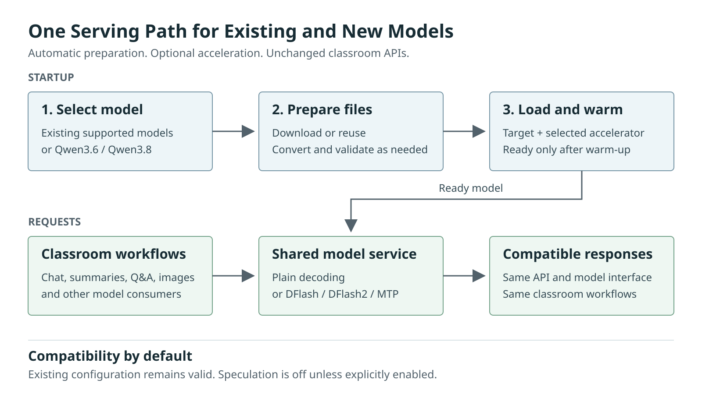

# Smart Classroom Vision-Language Model (VLM) and Large Language Model (LLM) Serving Design

**Status:** Implementation design. Unless explicitly identified as existing behavior, the following features and contracts are requirements, not claims of implemented or qualified support. Model and runtime qualification and performance results remain pending.

## 1. Key Features and Compatibility

This design covers shared model serving, speculative decoding, timing instrumentation, and offline benchmarking while preserving classroom inference interfaces.

| Key Feature | Stakeholder Benefit |
| --- | --- |
| **Qwen3.5, Qwen3.6, or Qwen3.8 model choice** | Serve Qwen3.5-9B INT4 and INT8, Qwen3.6-35B-A3B INT4, and Qwen3.8-27B INT4 and INT8 through the shared OpenVINO service. |
| **Tool calling on port 8000** | OpenAI-compatible function calls and tool-result conversations through `/v1/chat/completions`, enabling agent workflows without a separate endpoint. |
| **Selectable speculative decoding** | Choose DFlash, DFlash2 or supported MTP explicitly, with plain-generation fallback under the `auto` activation policy. |
| **Automatic first-run preparation** | Download the target and required speculative artifacts, convert them when needed, and reuse validated files on later starts. No pre-existing local model files are required. |
| **Backward compatibility** | Retain older models and configuration, the port-8000 API, `/v1/chat/completions`, and the shared classroom generation interface. |
| **Controlled activation** | Complete the warm-up of the selected model pipeline before reporting readiness, show the model's acceleration status, and handle failures safely. |
| **Workflow-stage and model-call timing statistics** | Measure processing time separately for workflow stages, including Automatic Speech Recognition (ASR), video analytics (VA), Optical Character Recognition (OCR), Summary, and Mindmap. Compare individual model calls by model, precision, device, and effective decoding method. |
| **Standalone `context_bench` benchmarking** | Compare model and runtime profiles using repeatable measurements of time to first token (TTFT), time per output token after the first (TPOT), throughput, and memory. Optionally assess retrieval accuracy and generation fidelity against a baseline. See [context-bench-design.md](context-bench-design.md). |

**Preserve existing model support**, including Qwen3-VL-8B-Instruct and Qwen3.5-9B, with unchanged providers, model IDs, precisions, local paths and generation behavior. No configuration migration or default model replacement is required; speculation remains switched off unless enabled. A model without a qualified accelerator continues through plain generation. Qualified serving profiles prepare missing artifacts automatically after software setup; the offline benchmark consumes prepared artifacts.

Keep one target per serving instance. Generating tool calls and consuming tool results are in scope; executing tools remains the client's or controller's responsibility. Multi-model routing, UI redesign, and NPU text-generation support are outside the scope; existing NPU use by other classroom components is unchanged.

## 2. Model Profiles

| Model | Target Artifacts | Optional Accelerator |
| --- | --- | --- |
| Previously supported VLM and LLM models | Preserve their supported download and export paths, and precisions | Plain generation; a drafter is not required |
| `Qwen/Qwen3.5-9B` | [INT4 intermediate representation (IR)](https://huggingface.co/OpenVINO/Qwen3.5-9B-int4-ov) or [INT8 IR](https://huggingface.co/OpenVINO/Qwen3.5-9B-int8-ov) | Plain generation; speculative decoding requires a separately qualified profile |
| `Qwen/Qwen3.6-35B-A3B` | [INT4 IR](https://huggingface.co/OpenVINO/Qwen3.6-35B-A3B-int4-ov) | [DFlash](https://huggingface.co/z-lab/Qwen3.6-35B-A3B-DFlash) |
| `Qwen/Qwen3.8-27B` | [INT4 IR](https://huggingface.co/OpenVINO/Qwen3.8-27B-int4-ov) or [INT8 IR](https://huggingface.co/OpenVINO/Qwen3.8-27B-int8-ov) | [DFlash2](https://huggingface.co/z-lab/Qwen3.8-27B-DFlash2) |

A Qwen3.5-9B selection uses `provider: vlm`, `vlm_name: Qwen/Qwen3.5-9B`, and `weight_format: int4` or `int8` under `models.text_gen`. Omit `speculative` for plain generation; listing the target artifacts does not qualify a speculative method or tool-call capability.

A maintained catalog supplies compatible combinations of targets and methods, default drafter sources, immutable revisions, conversion recipes, dependency versions, and tested tuning values. Explicit speculative settings select or override these defaults only within a validated profile. Drafter precision is independent of target precision. Extend the catalog without restricting the existing plain-model loading path.

A source checkpoint is not runtime-ready IR. Each accelerated profile must provide downloadable compatible IR or a tested conversion recipe for downloaded source files, including target hidden-state outputs where needed. Qualify the DFlash2 exporter and runtime independently. Multi-token prediction (MTP) uses the target's bundled prediction head and requires its own artifact and runtime qualification; it does not use either of the two external Dflash and Dflash2 z-lab drafters listed above. Select one mechanism per pipeline, never silently substitute or combine them.

## 3. Architecture

In the design requirements, serving has two phases: startup preparation and request handling.



Startup:
- A shared helper prepares model files once. The model owner, which can be the application, a supervised worker, or an independently operated server, loads and warms the model before serving classroom requests.
- Workers reuse prepared artifacts after restart.

Request Handling:
- Classroom workflows send requests to the ready model. The service limits how many requests it admits, can stream responses as they are generated, and supports cancellation.
- If a request is cancelled while native inference is still running, the service must keep that model capacity reserved until inference finishes.

Model upgrades do not require a new deployment topology. External clients do not download or manage the server’s model files. The server reports its actual model and acceleration state.

### Tool Calls on Port 8000

**`POST /v1/chat/completions` on port 8000 must support OpenAI-compatible function (tool) calling**, in streaming and non-streaming requests. Qwen3.6 and Qwen3.8 serving profiles must pass the tool-call qualification; older tool-capable models use the same contract, while ordinary chat remains available for models without tool support. All serving ownership modes expose this contract through the same application endpoint.

| Contract | Required Behavior |
| --- | --- |
| Conversation | Preserve the full ordered `messages` history: system or developer, user, assistant, and tool turns, including supported image content. Do not reduce it to the last user prompt. Assistant messages may have null content when they contain tool calls. |
| Tool definitions | Accept request-level `tools` entries with `type: "function"`, function name, optional description, and a JSON Schema `parameters` object. Render definitions and history through the selected model's tool-aware chat template. |
| Tool selection | Support `tool_choice: "none"`, `"auto"`, `"required"`, or a named function object. Default to `auto` when tools are supplied, otherwise `none`. Reject choices referring to absent tools. Honor `parallel_tool_calls: false` by returning at most one call; multiple calls, when allowed, each require a distinct ID. |
| Tool response | Return `choices[].message.tool_calls` with stable `id`, `type: "function"`, `function.name`, and JSON-encoded `function.arguments`. Normalize model-specific tool syntax into this structure. Finish a valid tool-call turn with `finish_reason: "tool_calls"`; an ordinary completed text turn uses `"stop"`. |
| Tool results | The client appends the assistant tool-call message and a `role: "tool"` message with matching `tool_call_id` and result `content`, then submits the conversation again. Validate call-to-result associations and duplicate or missing results in the submitted history; server-side conversation storage is not required. |
| Streaming | Emit OpenAI-compatible Server-Sent Events (SSE) `delta.tool_calls` with stable call indexes and IDs. Buffer each generated call until its name and arguments are complete and validated, then publish it; finish with `finish_reason: "tool_calls"` and `[DONE]`. Do not expose partially generated arguments as a completed call. |

Tool-call sequence from the design requirements:

1. Request with tools: The client sends a request that includes tool definitions.
2. Assistant tool call: The assistant returns a tool call: a request to use one of those tools, with its name and arguments.
3. Client-authorized execution: Execution is client-authorized. The controller independently validates the arguments, authorizes execution, and bounds tool-loop iterations. The serving process does not execute a function, open a shell, or performs an action merely because the model requested it.
4. Tool result message: The client appends the assistant's tool-call message and a `role: "tool"` message containing the result and matching `tool_call_id`, then resubmits the conversation.
5. Assistant answer or next tool call: The assistant uses the result to answer, or returns another tool call and the sequence continues.

Tool-call validation and failure handling from the design requirements:

- Before invoking generation, the serving endpoint validates request schemas, tool names, selection options, and model capabilities.
- The serving endpoint returns a clear 4xx error for malformed requests or unsupported tool or schema features; it must not ignore them.
- The service endpoint validates each generated call against the offered function’s supported JSON Schema, not only its required keys.
- The service endpoint does not report an invalid, truncated, or missing required call as a successful tool invocation. It preserves failure and truncation semantics.
- If a stream has already started, the serving endpoint terminates it with an error rather than signaling a successful tool-call completion.
- The controller independently validates arguments, authorizes execution, and limits tool-loop iterations.
- The controller treats tool results as untrusted conversation data; it does not authorize further actions.

## 4. Configuration

- **Reuse the current configuration structure and add an optional `models.text_gen.speculative` block.**
- Keep the activation policy (`mode`) separate from the decoding mechanism (`method`) and from the draft model’s identity and source.
- Continue to select the target with `vlm_name` and `weight_format`.
- Do not rename existing keys or add top-level blocks.

The following example uses the structure of [../../../config.yaml](../../../config.yaml), selects Qwen3.8 INT4 and adds the proposed DFlash2 settings. It is an illustrative profile, not a snapshot of every installation's values. Preserve existing generation, admission, chunking and segmentation settings when merging it. Omitting `speculative` preserves plain generation.

```yaml
models:
  text_gen:
    provider: vlm
    vlm_name: Qwen/Qwen3.8-27B
    device: GPU
    weight_format: int4
    max_new_tokens: 5120
    concurrency: 1
    queue_max: 8

    speculative:
      mode: auto
      method: dflash2
      draft_source: huggingface
      draft_model: z-lab/Qwen3.8-27B-DFlash2
      draft_revision: null
      num_assistant_tokens: null

    chunking:
      enabled: true
      max_prompt_tokens: auto
      max_content_tokens: 24000
      gpu_memory_safety_margin: 0.6
      map_max_new_tokens: 1536

    segmentation:
      window_max_new_tokens: 1024
      topics_target: 20
      topics_min: 15
      topics_max: 25
```

| Configuration Item | Required Behavior |
| --- | --- |
| Existing `provider`, `vlm_name`, `device`, `weight_format` | Keep names and meanings. For the new models use `provider: vlm`; select a listed model and precision combination. Keep an older installation's selection unless the operator changes it. |
| Existing `max_new_tokens`, `concurrency`, `queue_max` | Retain the installation's generation and admission limits; 5120, 1, and 8 are example values. A larger model does not automatically increase these limits. |
| Existing `chunking` and `segmentation` | Preserve the nested structure and configured values. Validate context and memory budgets for the selected model; change tuning only when measurements justify it. |
| New optional `speculative` block | Select activation policy, method, and draft artifacts without changing target or workflow settings. Defaults and validation are defined below. |

### Speculative Settings

| Field under `speculative` | Values and Default | Purpose |
| --- | --- | --- |
| `mode` | `"off"` (default), `auto`, `"on"` | Disable acceleration, allow plain fallback, or require acceleration. This is not the algorithm name. |
| `method` | `auto` (default), `dflash`, `dflash2`, `mtp` | Select the decoding mechanism. `auto` selects the catalog's declared method, not trial-and-error loading. Future methods require an explicit supported profile. |
| `draft_source` | `null` (profile default), `huggingface`, `local`, `target` | Distinguish a Hub repository, an explicit local IR directory, and target-bundled MTP artifacts. Other sources require a supported adapter and profile. |
| `draft_model` | Repository ID or local directory; `null` selects the profile default | Identify the external drafter for DFlash or DFlash2. For MTP, set to null: use the target's prediction head, not a second model. |
| `draft_revision` | Immutable repository commit; `null` selects the profile's pinned revision | Reproduce a Hub download. Reject non-null values for `local` or `target`; bundled MTP inherits the target revision. |
| `num_assistant_tokens` | Positive integer; `null` selects the tested default for the selected method and profile. | Control the draft block size within the selected runtime's supported range. Do not reuse DFlash tuning with either DFlash2 or MTP without validation. |

| Selected Target and Method | Draft Settings |
| --- | --- |
| Qwen3.6 INT4 with `dflash` | `draft_source: huggingface`, `draft_model: z-lab/Qwen3.6-35B-A3B-DFlash` |
| Qwen3.8 INT4 or INT8 with `dflash2` | `draft_source: huggingface`, `draft_model: z-lab/Qwen3.8-27B-DFlash2` |
| Target with a qualified bundled `mtp` head | `draft_source: target`, `draft_model: null`; download required MTP files with the target |

For example, replace only the speculative block with the following when the selected target has a qualified MTP profile:

```yaml
speculative:
  mode: auto
  method: mtp
  draft_source: target
  draft_model: null
  draft_revision: null
  num_assistant_tokens: null
```

Resolve and Validate:
- The helper resolves defaults before downloading, then validates the complete combination of target, method, source, and revision against artifact metadata and the supported profile.
- The model-serving software never changes an explicitly selected method if it fails; in `mode: auto`, the software falls back to the plain generation method.
- Unknown methods, contradictory sources, mismatched drafters, and out-of-range tuning fail the validation rather than triggering fallback. 
- In `"off"` mode, the helper ignores dormant speculative settings and prepares only the target.

Prepare Artifacts:
- The helper uses the catalog’s pinned Hub sources for first-run downloads. `draft_source: local` requires a non-empty `draft_model` directory and a null `draft_revision`; the helper validates the existing IR and does not download a replacement if it is missing. 
- The helper resolves relative directory paths from the Smart Classroom root.
- `draft_source: target` is valid only with MTP, and requires `draft_model` and `draft_revision` to be set to null.
- The startup preparation flow ensures that a source override or revision cannot bypass compatibility checks, enable arbitrary URLs or execute repository code.
- The manifest records resolved settings and actual artifact versions, including defaults.

Tool Calls:
Tool definitions and selection are per-request API fields (`tools`, `tool_choice`, and `parallel_tool_calls`), not new YAML settings or a separate service. Record tool and template capability in the model profile so unsupported requests fail before streaming; no `enable_tool_call` configuration flag is needed.


## 5. Model Preparation

The model owner prepares artifacts during model initialization, before reporting readiness. The shared preparation logic in `components/vlm/text_gen_prepare.py` is called from the VLM load path. As a result, [start-smart-classroom.ps1](../../start-smart-classroom.ps1), the desktop application [start-desktop-app.ps1](../../start-desktop-app.ps1), and `python main.py` use the same preparation process; none requires a separate launcher step or switch.

On first start, the helper downloads or converts missing artifacts. On later starts, it reuses and validates existing artifacts, rebuilding derived artifacts when source hashes change. Dependent services wait for the model owner’s `/health` endpoint before using the model. Request handlers do not download or convert files.

The following steps describe the model-preparation requirements. MTP preparation is planned; the design does not currently list a qualified MTP profile.

1. **Select:** The helper resolves the target, speculative policy, method, and source. It validates explicit settings, then selects a compatible catalog profile. Before downloading, it validates the resolved target, method, source, and revision against artifact metadata and the selected profile. If a recognized method lacks runtime or profile support, the helper uses plain generation in `auto` mode or returns an actionable error in `"on"` mode.

2. **Prepare:** The preparation helper downloads the target’s catalog IR and, for Hub drafters, the pinned drafter files over HTTPS. For `local`, it validates the specified IR directory without downloading a replacement drafter. For a qualified MTP profile, the helper acquires the target’s bundled head and metadata without downloading an unrelated external model. It uses runtime-ready IR directly and converts downloaded sources only through the profile’s qualified recipe. Network failures do not trigger unrelated export attempts.

3. **Validate:** The helper checks required files, integrity, tokenizer and processor compatibility, runtime versions, and target and drafter graph interfaces. It preserves the ordinary target if accelerated export needs separate IR. It records a manifest without overwriting active files or changing legacy model paths.

4. **Activate:** After preparation succeeds, the model owner loads the resolved artifacts and runs warm-up. The service reports readiness only after warm-up succeeds; a completed download alone does not mean the model is ready.

Preparation creates storage on demand, uses resumable staging and per-artifact locks, and publishes only complete, validated artifacts. It bounds retries and checks disk space for weights and conversion intermediates. It keeps prior valid artifacts for rollback. When preparation reuses legacy files, it validates them without claiming unknown provenance.

### Launcher Behavior

| Invocation | Behavior |
| --- | --- |
| Normal startup | Download/prepare missing selected files, then start services under the failure policy below. |
| `-DownloadModelsOnly` | Prepare without changing services or running inference warm-up. Require all artifacts for the selected method: target plus external drafter, or target plus bundled MTP head. Return nonzero if incomplete, even in `auto`; this includes a missing accelerated profile. |
| `-SkipModelDownload` | Validate existing text-generation artifacts only; no network, conversion or dependency installation. An empty target cache fails. May combine with download-only to validate an offline bundle. |
| `-Silent` | No prompts; report outcome and exit status. It may restart existing services during normal startup, but never during download-only preparation. |

These are intended launcher behaviors; the preparation switches are part of the proposed change. Initialize proxy/environment settings before download-only dispatch, then exit before elevation, restart or cleanup. Reject download-only with desktop delegation or an externally owned server. Forward supported options through relaunch paths. Preparation requires no elevation and must not trigger service cleanup on failure.

Cache-only operation covers text generation, not ASR, embeddings, OCR/grading or frontend dependencies. Install trusted exporter dependencies during software setup. Validate paths and downloaded metadata, never execute repository code, and preserve TLS verification. Pass arguments as data and credentials/proxy settings through the environment without logging secrets.

## 6. Generation and Failure Policy

DFlash/DFlash2 uses an external drafter; MTP uses the target's bundled prediction head. The target verifies proposed tokens. The qualified OpenVINO runtime owns drafting and acceptance; the application selects one method and enforces readiness and request policy.

Validate DFlash/DFlash2 hidden-state outputs and vocabulary alignment; for MTP, validate the bundled head and its target/runtime contract instead. Check the complete runtime/exporter dependency set for each method. Keep method-specific scheduler and draft-block memory settings isolated from plain generation. Budget target, speculative artifacts, image processing and other classroom memory together.

Initially accelerate text-only greedy generation. Preserve image support through tested plain VLM decoding; do not claim image-encoding speedups. Reject unsupported sampling on an active speculative pipeline before streaming rather than silently changing the request. Plain generation retains each model's supported behavior. `"on"` requires speculative readiness at startup, not acceleration of every request.

Tool calling is independent of speculative decoding: it must work with speculation off, and every advertised tool-capable DFlash/DFlash2/MTP profile must pass the same call/result and streaming tests. Speculation must not drop tool definitions, change call IDs, expose unverified draft tokens or bypass argument validation. Reject an unsupported model/method/tool combination before generation; do not silently remove tools or switch speculative methods.

| Condition | `"off"` | `auto` | `"on"` |
| --- | --- | --- | --- |
| No qualified profile for the selected method, including an older model | Use plain model | Use plain model; report reason | Fail with guidance to use plain mode |
| Missing selected files, with a qualified profile available | Acquire target only | Prepare target and method-specific artifacts | Prepare target and method-specific artifacts |
| Target unavailable after permitted preparation | Fail | Fail | Fail |
| Speculative artifact acquisition, conversion or activation fails | Not applicable | Warm a plain pipeline once, after safe cleanup | Fail |
| Invalid active method/source/tuning, mismatched target/drafter or integrity failure | Fail for active target | Fail | Fail |

The cache-only switch prevents acquisition even when files are missing; `local` draft sources also prohibit replacement downloads. Download-only requires every artifact for the requested method; a normal `auto` fallback is not successful accelerator qualification.

If native cleanup cannot be confirmed, stop the model process before recovery. Retain the plain-mode decision for that launch so recovery does not repeatedly activate a failing drafter. Never replay a partially streamed request. Roll back by restoring the previous model/artifacts or disabling speculation and restarting, not by deleting caches.

Health reports the target, tool-call capability, requested/effective method, drafter identity or target-bundled head, warm-up result and sanitized fallback reason. Detailed revisions, tuning and runtime versions remain available for diagnostics without exposing private local paths. Do not log sensitive tool arguments or results by default.

## 7. Processing-Time Statistics

Collect statistics at two levels: **workflow-stage elapsed time** for the classroom experience and **individual model-call time** for inference cost. These are nested measurements, not interchangeable values. Existing timing sources are identified under Collection and Reporting; the remaining coverage requires implementation.

### Workflow Stages

Measure each enabled stage from execution start through completion of its output, including preprocessing, model calls and postprocessing. Record admission/queue wait separately and include it in request end-to-end latency. Use seconds for stage durations and milliseconds for per-frame or per-call latency.

| Stage | Processing-time boundary and breakdown | Workload and additional statistics |
| --- | --- | --- |
| Media preparation | Input decoding, audio extraction and chunk preparation | Media duration, chunk count and preparation seconds; identify work already included in ASR |
| ASR | Consume audio chunks through final transcript persistence; separate input wait, transcription and optional diarization | Audio seconds, chunk count, ASR and diarization model-call times; real-time factor = processing seconds / audio seconds for a fixed recorded input |
| VA (video analytics) | First accepted frame through final analytics output for a fixed clip; separate decode, model inference, tracking and aggregation | Per-stream processed/dropped frames, achieved FPS, frame-latency p50/p95 and each detector, pose, classifier or re-identification model's time; report live observation duration separately |
| OCR | Frame/page selection through persisted recognized text; separate extraction, detection, recognition and merge | Frames/pages processed and per-image latency; report board OCR and document OCR separately |
| Summary | Summary execution through final saved summary, including map/fold/reduce calls when chunking is active | Strategy, chunk count, map/fold and reduce times, total seconds, time to first token (TTFT), input/output tokens and decode tokens/s |
| Mindmap | Summary input preparation through generated, validated and saved mindmap | Model-call time, validation/persistence time and any repair attempts; distinguish insufficient-input fallback from model generation |
| Topic segmentation | Transcript preparation through validated and saved topics | Window count, per-window model times and topic count; measure subsequent embedding/indexing separately |
| Report | Session-data collection through completed report generation and persistence | Collection, model generation and rendering/export times; identify cached re-selection or reports requiring no model call |
| Content search ingestion | Accepted ingestion task through searchable content | Queue wait, extraction/video captioning, embedding and indexing times; document/page/frame/chunk counts |
| RAG Q&A | Accepted question through final answer | Retrieval, reranking, prompt preparation and generation times; TTFT and input/output tokens |
| Grading | Accepted grading task through completed result | Layout/detection, OCR/VLM calls and result assembly; page/question counts and retry times |

ASR, VA and board OCR can overlap, and several stages may share the text-generation queue. Measure workflow wall time directly from workflow start to completion of all requested outputs; **do not sum stage durations to infer end-to-end latency**. Record the enabled stages and whether the run is live, recorded-media replay or an isolated stage benchmark. For live workflows, also report time from input completion to final output so recording duration is not mistaken for inference cost.

### Individual Models

Time each invocation at the model owner, retaining its parent stage and an opaque run/request identifier. Group by actual model/artifact revision, precision, device, hardware platform, runtime version and effective decoding method. A shared Qwen model must remain attributable to Summary, Mindmap, segmentation, reports, captioning, Q&A or grading rather than becoming one unattributed total.

| Model-call statistic | Definition |
| --- | --- |
| Call latency | Monotonic elapsed time from model invocation to final output, excluding admission wait; include preprocessing/postprocessing performed inside that boundary and label it accordingly. Report runtime inference-only time separately when available. |
| Generative breakdown | Input/image preparation, prefill and decode time when exposed by the runtime; model TTFT, prompt/output token counts and decode tokens/s. Do not estimate unavailable subphase timings by subtraction. |
| Non-generative breakdown | Inference time per audio chunk, image, frame or batch, with input dimensions/duration and batch size; keep detection, recognition, embedding and reranker models separate. |
| Speculative decoding | Requested/effective method and fallback status; target verification time, drafter or bundled-head time and accepted/proposed tokens when exposed by the runtime. These are subphases of the call, not extra workflow stages. |
| Startup | Download, conversion, model load/compile and warm-up times recorded separately from warm-request latency. |

Use the generation metric definitions and source/boundary rules in the [benchmark metrics section](context-bench-design.md#7-iteration-metrics-and-comparison-rules). Keep model TTFT distinct from client-visible TTFT, which also includes request preparation, queueing, transport and earlier map calls. Record durations locally within each process; do not subtract monotonic timestamps from different processes or hosts.

For every model/precision in Section 2, report call-latency mean/p50/p95, TTFT and decode throughput across the platform/method matrix in Section 8. Include the installed model as the compatibility baseline. ASR, VA, OCR, embedding and reranker models use the applicable per-call statistics with their actual configured identities.

### Collection and Reporting

Reuse existing timing sources while preserving their meanings: [ASR](../../../components/asr_component.py) writes `performance.transcription_time`; [Summary](../../../components/summarizer_component.py) writes `performance.summarizer_time`, `performance.summary_map_time`, `performance.ttft`, `performance.reduce_ttft` and `performance.tps`; [Report](../../../components/report_generator/report_generator.py) writes collection, generation and total times. These are component timers, not isolated model benchmarks. ASR includes upstream input waiting and optional diarization; the report generation timer also includes rendering/persistence. [Hardware monitoring](../../../monitoring/monitor.py) provides utilization, memory and power samples, not model-call latency. Keep these existing fields compatible and add the missing stage/call measurements at their owning boundaries.

Retain one record per stage attempt and model invocation so repeated calls, retries and failures are not overwritten by a last-value metric. Use monotonic clocks and finalize timers on success, failure or cancellation; for streaming, measure through generator completion, not generator creation. Separate client cancellation time from the end of any continuing native inference. Record status, counts and timing metadata only, with bounded retention; exclude prompts, transcripts, images, tool arguments/results, student identifiers, credentials and private paths.

For each stage and model group, publish successful sample count, total processing time, mean, min/max, p50 and p95, plus failed/cancelled attempt counts and their elapsed time separately. Mark skipped stages as not applicable and missing or unsupported measurements as unavailable, never zero. Treat existing negative sentinel values as unavailable. Preserve raw samples, units, measurement boundaries and the percentile calculation method; a single run is an observation, not a latency distribution.

Compare repeated warm runs using the same fixed inputs, prompt templates, token limits, chunking, concurrency, media settings and enabled stages. Publish hardware/driver/runtime/artifact versions, input durations or dimensions, token counts, warm-up/repetition counts, quality outcomes and an evidence link with every result. Separate isolated model benchmarks from concurrent classroom runs and cold-start measurements. Compute speedup only between matched plain/accelerated cases using the same latency statistic; report actual fallback as plain generation, not accelerated success.

## 8. Release Decisions

| Area | Required checks |
| --- | --- |
| Backward compatibility | Load unchanged older configurations; retain existing key names, token/queue limits, chunking, segmentation and service endpoints. Test supported providers/model IDs, precisions and local paths; no drafter download when off; plain fallback in `auto`; no regressions from runtime dependency upgrades. |
| Model/precision support | For every Section 2 profile, test empty-cache preparation, warm-up and later cache-only reuse. Plain mode downloads only the target; an accelerated case requires all artifacts for its selected method. |
| Port-8000 tool calling | End-to-end function definition -> tool call -> tool result -> answer through `/v1/chat/completions`, with streaming and non-streaming clients. Test `none`/`auto`/`required`/named choices, multiple-call IDs, `parallel_tool_calls: false`, full history, malformed arguments, missing results, truncation, unsupported models and no server-side tool execution. |
| Speculative configuration | Missing/mode-only blocks, all supported methods, explicit/default Hub revisions, local path handling and tuning bounds. Reject cross-model drafters and MTP with an external draft source/model; bundled MTP must never trigger a z-lab download. |
| Classroom quality | Streaming/non-streaming text, images, supported thinking/structured output, cancellation and queue limits; summaries, mind maps, segmentation, reports, RAG Q&A, video summaries and grading. |
| Reliability | Invalid pairs and corrupt artifacts, network/disk failures, interrupted/concurrent downloads, safe startup fallback and non-disruptive download-only behavior on Windows PowerShell 5.1/7. |
| Performance | Repeated plain/accelerated comparisons: answer quality, time to first token, tokens/s, end-to-end p50/p95 latency and peak memory. Separate download/conversion/compile time from inference. |
| Timing statistics | Publish stage and individual-model results defined in Section 7 for each qualification case. Verify attribution for shared models, overlapping stages, streaming completion, retries, failures, cancellation and skipped stages; retain raw samples and do not present unavailable timings as zero or pending cases as measured. |
| Context bench | Complete the [benchmark implementation and tests](context-bench-design.md#10-implementation-sequence-and-verification); verify exact-context and matched-profile measurements, separate accuracy verdicts, interruption-safe evidence, nonzero failure exits and unchanged source/serving artifacts. Publish model-call evidence without presenting it as full classroom-workflow timing. |

The required GPU matrix covers Arrow Lake (ARL) and Panther Lake (PTL): Qwen3.5-9B INT4/INT8 plain on both platforms (four cases), plus Qwen3.6 INT4 and Qwen3.8 INT4/INT8 with plain and their respective DFlash/DFlash2 methods on both platforms (twelve cases). These sixteen cases are planned qualification, not reported passes; DFlash2 remains blocked until its adapter/runtime is qualified. Add older-model regressions and separate MTP cases for each advertised target/precision/platform; do not infer support across methods. Include tool-call round trips for tool-capable profiles. CPU qualification is separate; identify exact hardware, artifacts, runtime/driver versions and workload settings in every result.
