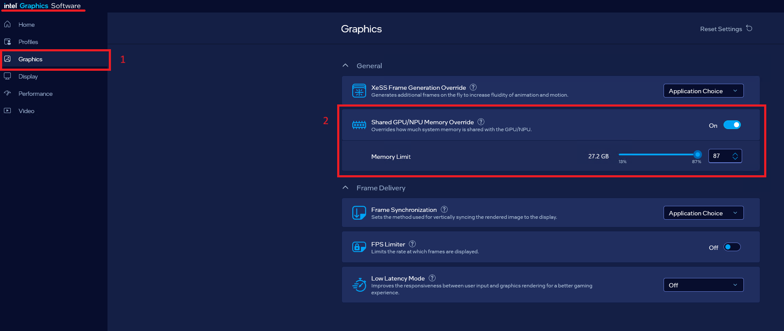

# Advanced Setup Guide

This guide is the configuration reference for the Smart Classroom desktop app on
Windows, with troubleshooting and uninstall steps. To install the app, see
[Get Started on Windows](./get-started/get-started-windows.md).

## Where the Configuration Lives

Edit the settings on the **Configuration** screen. They are saved to
`%LOCALAPPDATA%\SmartClassroom\config.yaml`, which **Show file** opens. The screen
covers the settings most people change; for a setting it does not list, edit
`config.yaml` directly.

> [!IMPORTANT]
> Configuration changes take effect the next time the backend starts. Select
  **Restart backend** when it is offered after you save, or restart it on the
  **Services** screen.

## Configure the Application

### A. Enable Feature Configuration

The application uses a modular feature architecture. You can enable or disable individual features through the `features:` block in `config.yaml`. Only enabled features are initialized at startup: they load their required models, register their API routes, and start their associated services.

```yaml
features:
  asr:                { enabled: true }   # Speech-to-text transcription
  summary:            { enabled: true }   # AI class summary / report
  mindmap:            { enabled: true }   # Mind map generation
  topic_segmentation: { enabled: true }
  video_analytics:    { enabled: true }   # Video ingestion / analytics
  board_ocr:          { enabled: true }   # OCR of the teacher's display (IFPD)
  content_search:     { enabled: true }   # Multimodal search + RAG service (port 9011)
  qa:                 { enabled: true }   # RAG-based Q&A over uploaded materials
  grading:            { enabled: true }   # VLM-based exam paper grading
  report:             { enabled: true }   # Class report generation (.docx, PDF export)
```

### B. Default Configuration

By default, the project uses Whisper for transcription, and summarization runs on the shared OpenVINO™ vision-language model configured under `models.text_gen`. You can modify these settings in `config.yaml`:

```yaml
asr:
  provider: openvino            # Supported: openvino, openai, funasr
  name: whisper-base         # Options: whisper-tiny, whisper-small, paraformer-zh etc.
  device: CPU                 # Whisper currently supports only CPU
  temperature: 0.0

summarizer:
  mode: dialog                # Supported: dialog, teacher, hybrid

text_gen:                     # Shared by summary, mindmap, segmentation and Q&A
  provider: vlm
  vlm_name: Qwen/Qwen3-VL-8B-Instruct
  device: GPU                 # Options: GPU or CPU
  weight_format: int4         # Supported: fp16, int4, int8
  max_new_tokens: 5120        # Maximum tokens to generate
```

For choosing the text-generation model and enabling DFlash, see the
[VLM/LLM Serving Guide](./vlm-llm-serving/serving-guide.md).

### C. Chinese Audio Transcription

For Chinese audio transcription, switch to FunASR with Paraformer in `config.yaml`:

```yaml
asr:
  provider: funasr
  name: paraformer-zh
```

Please also set the language to Chinese at the app level:

```yaml
app:
  language: zh
```

### D. Content Search Configuration

**Upload Size Limits** can be adjusted under the `content_search` section:

```yaml
content_search:
  storage:
    document_max_mb: 100    # maximum upload size for documents (MB)
    video_max_mb: 1024      # maximum upload size for videos (MB)
```

**Document OCR**: To also extract text from images embedded in uploaded documents, turn on OCR for content search:

```yaml
content_search:
  ocr_enabled: true
```

> [!NOTE]
> This flag affects only document ingestion. Board OCR uses OCR independently and is not affected.

### E. Board OCR Configuration

Board OCR extracts text from the teacher's interactive display (IFPD) during a session, feeding the board summary and class report. It has the following configurations:

```yaml
board_ocr:
  frame_rate: "1/3"    # frames per second sampled from the board video
  debug: false         # keep the uncleaned board_ocr_raw.txt alongside the output
```

> [!NOTE]
> When Board OCR is enabled, the AI-generated class summary automatically gains an extra **"Board / IFPD Content"** section that summarizes the text captured from the display, in addition to the sections derived from the audio transcript.

### F. Speaker Diarization Setup (Optional)

Speaker diarization labels each transcript line with the speaker who said it. Two backends are
available:

| Backend | Gated access | Speed (CPU) | Notes |
| :--- | :--- | :--- | :--- |
| `pyannote` (default) | Yes, Hugging Face token required | ~0.43x realtime | Detects overlapping speech |
| `campplus` | No | ~0.01x realtime | FunASR VAD + CAM++, requires the FunASR setup from section C |

Steps a-c below set up the default pyannote backend. Skip to step d for CAM++.

#### a. Request model access on Hugging Face

Pyannote diarization models require gated access.

Request access here:

[Pyannote Speaker Diarization Community v1](https://huggingface.co/pyannote/speaker-diarization-community-1)

Click "Request Access" on the model page and wait for approval.

#### b. Create a Hugging Face access token

After approval:

Go to the [Hugging Face Access Token](https://huggingface.co/settings/tokens) page.

Create a Read access token.

Copy the generated token.

#### c. Configure the Hugging Face token

In the desktop app, open **Configuration**, go to **Speech recognition**, turn on
**Speaker diarization**, and enter the token in **Hugging Face token**. The app stores
the token without showing it again.

<!-- SCREENSHOT: Configuration screen, Speech recognition with Speaker diarization and Hugging Face token -->

To edit the file directly instead, set `diarization: true` under `models.asr` in
`config.yaml`, then add your Hugging Face token:

```yaml
models:
  asr:
    diarization: true
    hf_token: "hf_your_access_token_here"
```

> [!NOTE]
> The diarization model downloads automatically on next startup once `diarization: true` is set.

#### d. CAM++ backend (FunASR only)

`campplus` needs no token and no gated access, but it requires `provider: funasr` and
`name: paraformer-zh` from section C. Its speaker and VAD models are downloaded from ModelScope
on first use and reused offline afterwards.

```yaml
models:
  asr:
    diarization: true
  diarization:
    backend: campplus
```

#### e. Whole-file processing (FunASR only)

By default audio is transcribed and diarized in chunks, which streams results to the UI while
the recording is still being processed. Setting `chunking: false` processes the whole recording
in a single pass instead: speaker clustering sees all the speech at once, at the cost of no
intermediate results. It also requires `provider: funasr` and `name: paraformer-zh`, and is
ignored for microphone capture, where the recording is not available up front.

```yaml
audio_preprocessing:
  chunking: false
```

## Install LibreOffice (Optional, Feature-Dependent)

LibreOffice (the `soffice` executable) is an **optional** dependency used by two features. Install it only if you enable a feature that needs it:

- **`report` — PDF report export:** The class report is generated as a `.docx` file. When you download it as **PDF**, the server converts the `.docx` using LibreOffice in headless mode (`soffice --convert-to pdf`). If LibreOffice is **not** installed, `.docx` download still works normally and only the PDF download returns `501 (PDF export unavailable)`.
- **`content_search` — legacy document parsing:** Ingesting legacy Office formats (`.doc`, `.ppt`, `.xls`) requires LibreOffice to convert them. Modern formats (`.docx`, `.pptx`, `.xlsx`) do not need it. If LibreOffice is missing, uploading a legacy format is rejected with a message asking you to install it or convert to a modern format.

If you enable either use case, download and install LibreOffice from [https://www.libreoffice.org/download/](https://www.libreoffice.org/download/), then make sure the `soffice` executable is available on your system `PATH`. Restart the backend afterwards.

To verify the executable is discoverable, run this in PowerShell:

```PowerShell
Get-Command soffice
```

## Network Requirements

- **Proxy**: If you are behind a proxy, set `HTTP_PROXY` and `HTTPS_PROXY` on the
  **Configuration** screen under **Proxy**.
- **Model downloads**: Stable access to `huggingface.co` is required to download
  pre-trained models.
- **Windows long paths**: Model downloads with deep paths can fail when long paths are
  disabled. Select **Enable** on the **Windows long paths** row of the **Setup** screen.

## Troubleshooting

In the steps below, the `models` folder is `%LOCALAPPDATA%\SmartClassroom\models`.
Stop the backend before you delete it.

- **Backend fails to start or stops unexpectedly:**
  Open **Services** and read the backend's live logs, or select **Open folder** to see
  the log files. Then open **Setup** and select **Re-check**: a row marked **Missing**,
  **Outdated**, or **Failed** names what to fix. **Copy diagnostics** copies the full
  check list for a bug report.

- **Error: `Port for tensor name cache_position was not found.`**
  This means the models were not configured correctly.
  To fix this:

  1. Delete the `models` folder.
  2. Open **Setup** and select **Upgrade** on the **Python environment** row.
  3. Start the backend again. The models are downloaded and converted again.

- **Application crash during bring-up on Intel® Core™ Ultra Series 3 and Intel® Core™ Series 3 processors without any error indication:** Sometimes OpenVINO™ GenAI models may crash on newer hardware. Try running the model on CPU by setting `device: CPU` under `models.text_gen` in `config.yaml`.

- **Tokenizer load issue:**

  If you see this error:

  ```bash
  Either openvino_tokenizer.xml was not provided or it was not loaded correctly. Tokenizer::encode is not available
  ```

  Delete the `models` folder and start the backend again.

- **Error: `CL_OUT_OF_RESOURCES`** during summarization of longer audio inputs:
  Summarization of longer transcripts may require additional GPU memory. If this error occurs, increase the GPU memory allocation in the **Intel® Graphics Software** application under the **Graphics** tab before rerunning the workflow.

  

### Known Issues

- **Live Video Monitoring Timeout**: Live video monitoring sessions stop automatically after 45 minutes unless you reload the page to start a new session.
- **Stream End Notification**: When video streaming ends, a "Stream not found" message appears on the screen, indicating that the stream has concluded.
- **Do Not Reload During Active Streaming**: Do not reload the page while the stream is active. Reloading terminates the session, and you lose the current stream. Wait until the "Stream not found" notification appears before reloading.
- **Video Ready Notification**: If the URL is configured in the settings, the notification will display "Video Ready" unless the screen is reloaded. Reloading the screen will reset the session and the notification.

## Uninstall the Application

To uninstall the desktop app:

1. Stop the backend on the **Services** screen and close the app.
2. Open **Settings** > **Apps** > **Installed apps**, find **Smart Classroom**, and
   select **Uninstall**.
3. On the **Uninstall Options** page, choose what happens to your data in
   `%LOCALAPPDATA%\SmartClassroom` (settings, Python environments, models, sessions,
   and content search data):
   - Leave **Delete this data as well** unchecked to keep it for a later installation.
   - Check it to delete the folder too. If some files are in use, the uninstaller
     tells you to delete the folder after restarting Windows.

The option only covers the data of the Windows user running the uninstaller. Other
users of an installation for everyone keep their data.

<!-- SCREENSHOT: Settings > Apps > Installed apps with Smart Classroom and the Uninstall option -->
<!-- SCREENSHOT: Uninstaller, Uninstall Options page -->

## Learn More

- [System Requirements](./get-started/system-requirements.md): Hardware, software, supported models, and weight formats.
- [Get Started](./get-started.md): Quick installation and setup instructions.
- [Application Flow](./application-flow.md): End-to-end application flow.
- [Content Search Flow](./content-search-flow.md): The flow of the content search functionality.
