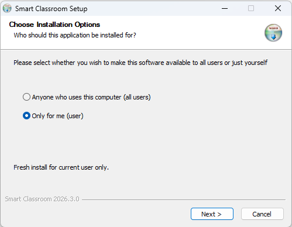
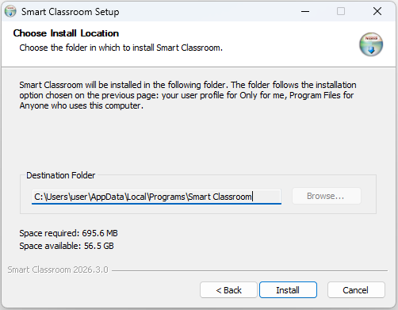
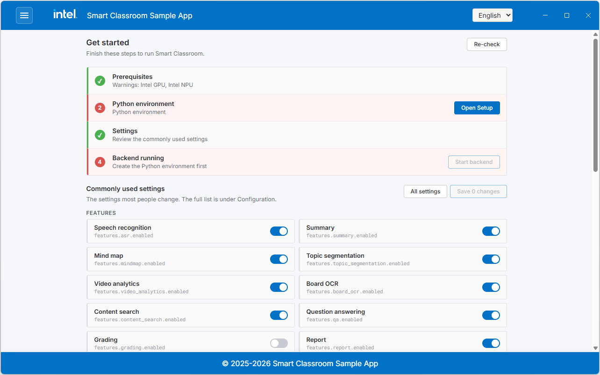
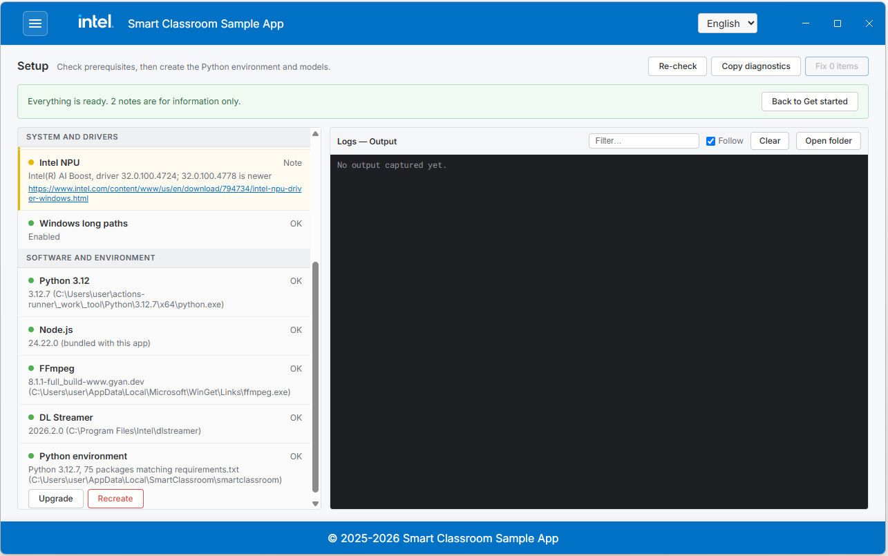
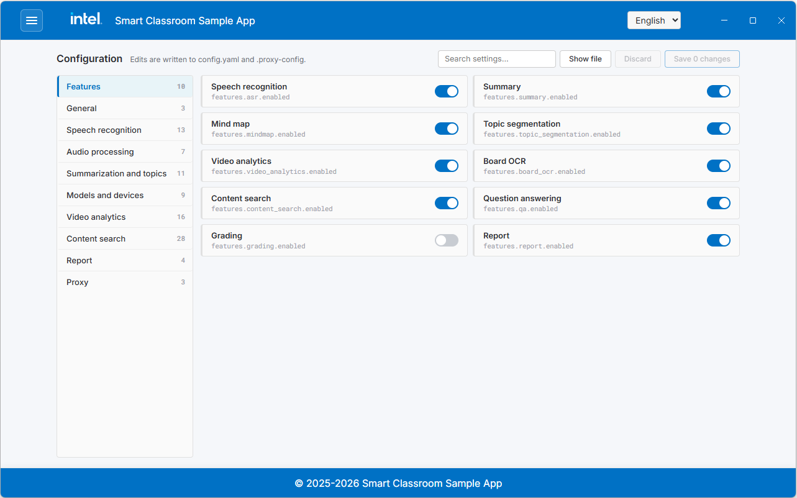
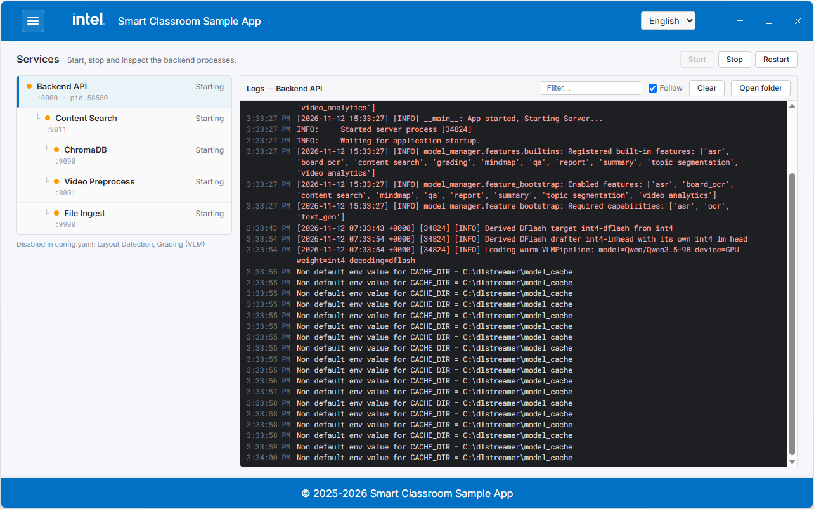

# Get Started on Windows

Smart Classroom for Windows is distributed as a desktop application installer. The
app checks and installs the prerequisites, edits the configuration, and starts and
stops the backend services, all from one window.

> [!NOTE]
> To build the installer yourself, see
> [Build the Installer from Source](./build-from-source-windows.md).

## Step 1: Download the Installer

1. Check that your machine meets the [System Requirements](./system-requirements.md).
2. Open the [Releases page](https://github.com/open-edge-platform/education-ai-suite/releases)
   of the repository.
3. Under **Assets** of the release you want, download
   `SmartClassroom-<version>-setup.exe`.

> [!NOTE]
> The app checks the Intel GPU and NPU drivers but does not install them. Install or
> update the [NPU driver](./system-requirements.md#software-and-hardware-requirements)
> from an administrator account before you start.

## Step 2: Install the App

Run `SmartClassroom-<version>-setup.exe` and follow the installer:

1. **Choose Installation Options**: install for **Anyone who uses this computer**
   (requires administrator approval) or **Only for me**.
2. **Choose Install Location**: shows where the app will be installed. The folder
   follows the option chosen on the previous page and cannot be changed:
   `%LOCALAPPDATA%\Programs\Smart Classroom` for **Only for me**, and
   `C:\Program Files\Smart Classroom` for **Anyone who uses this computer**.
3. **Finish**: the installer adds a **Smart Classroom** shortcut to the desktop and the
   Start menu, and can launch the app right away.

<!--hide_directive{w=400px}hide_directive-->

<!--hide_directive{w=400px}hide_directive-->

The installed program folder is not modified while the app runs. Settings, models,
the Python environment, sessions, and logs are stored separately for each Windows
user, also when the app is installed for everyone; see
[Where Your Data Is Stored](#where-your-data-is-stored).

## Step 3: Complete the Setup Screen

Launch **Smart Classroom** from the desktop or the Start menu. While anything still
needs doing, the app opens on the **Get started** screen, which lists what is missing.
The menu button at the top left switches between screens.

<!--hide_directive{w=700px}hide_directive-->

Follow the links on **Get started**, or open **Setup** directly, and work down the list:

| Section | Covers |
| :--- | :--- |
| **System and drivers** | Operating system, processor, memory, free disk space, Intel GPU and NPU drivers, Windows long paths |
| **Software and environment** | Python 3.12, Node.js (bundled with the app), FFmpeg, DL Streamer, the Python environment, and the grading conversion environment and layout detection model |

Each row shows what was found and what it blocks. Rows the app can fix have a button:

- **Install** for Python, FFmpeg, and Deep Learning Streamer (DL Streamer)
- **Create** for the Python environment and the grading conversion environment
- **Prepare** for the layout detection model
- **Enable** for Windows long paths (shows an administrator prompt)

**Fix _n_ items** at the top runs everything outstanding in order. Progress appears in
the **Output** pane below, and **Copy diagnostics** puts the whole list on the
clipboard for a bug report.

<!--hide_directive{w=700px}hide_directive-->

> [!IMPORTANT]
> If you are behind a proxy, set `HTTP_PROXY` and `HTTPS_PROXY` on the **Get started**
> or **Configuration** screen before you run the Setup actions. The installs and model
> downloads use these values.

> [!NOTE]
> Creating the Python environment downloads several gigabytes, and preparing
  the layout detection model downloads and converts it. Both take a while on a first run.

The backend cannot start until the Python environment exists.

## Step 4: Review the Settings

**Get started** shows the settings most people change. The **Configuration** screen has
the full list from `config.yaml` and `.proxy-config`, grouped and searchable.
**Show file** opens the file the screen writes to. For what each setting does, see
[Configure the Application](../advanced-setup-guide.md#configure-the-application).

<!--hide_directive{w=700px}hide_directive-->

> [!NOTE]
> Speaker diarization (identifying who is speaking) is optional and requires a
  one-time Hugging Face access token. The **Get started** screen flags this when
  diarization is enabled without a token; set it under **Configuration**, or see
  [Speaker Diarization Setup](../advanced-setup-guide.md#f-speaker-diarization-setup-optional).

## Step 5: Start the Backend

The backend does not start on its own. Start it in either of these ways:

- Select **Start backend** on the **Get started** screen.
- Open **Services** and select **Start** on the backend row.

<!--hide_directive{w=700px}hide_directive-->

The **Services** screen shows the backend and every service it starts, with their
status and live logs. Use **Stop** and **Restart** there as needed. The first start
downloads and prepares the AI models, so it takes longer than later starts.

When you save a configuration change while the backend is running, the app offers
**Restart backend** so the change takes effect.

## Step 6: Use the App

Once the backend is running, open **Home**, **Content Search**, or **Grading** from the
menu.

| Screen | What it does |
| :--- | :--- |
| **Home** | Audio transcription, summary, mind map, video analytics, and class reports |
| **Content Search** | Upload materials, search them, and ask questions about them |
| **Grading** | Grade exam papers against a rubric |

For a walkthrough of each feature, see [Application Flow](../application-flow.md),
[Content Search Flow](../content-search-flow.md), and [Grading Flow](../grading-flow.md).

## Update to a New Version

1. Stop the backend on the **Services** screen and close the app.
2. Download and run the newer `SmartClassroom-<version>-setup.exe`. It installs over
   the existing version in the same folder; you do not need to uninstall first.
3. Launch the app and open **Setup**. If the **Python environment** row shows
   **Outdated**, select **Upgrade** to match the new release's requirements.

Models, the Python environments, sessions, and content search data are kept across
updates. Your settings are kept too, unless the new version ships different default
settings:

- On the first start after such an update, `config.yaml` and the grading
  configuration are reset to the new defaults, and a message tells you so.
- The previous files are saved in `logs\config-backups` as `pre-update.*.bak`.
  Re-enter the settings you had changed, including the Hugging Face token, on the
  **Configuration** screen.
- Proxy settings (`.proxy-config`) are not reset.

## Where Your Data Is Stored

Everything the app writes is under `%LOCALAPPDATA%\SmartClassroom\` of the Windows user
running it:

| Path | Contents |
| :--- | :--- |
| `config.yaml`, `.proxy-config` | Your settings, edited through the **Configuration** screen |
| `smartclassroom\` | Python environment for the backend |
| `venv_convert\` | Grading conversion environment |
| `models\` | Downloaded and converted AI models |
| `storage\` | Session recordings, transcripts, summaries, and reports |
| `content_search\` | Uploaded materials and the content search vector database |
| `grading\` | Grading configuration, uploaded rubrics, and grading results |
| `logs\` | Service logs (**Open folder** on the **Services** screen opens them) and configuration backups, including the `pre-update.*.bak` files saved by updates |
| `state\` | Records which shipped default settings your configuration came from |
| `huggingface\`, `paddlex\`, `pip-cache\` | Download caches |

## Automated Deployment

The installer accepts the standard silent-install options:

```powershell
# Install silently for the current user
.\SmartClassroom-<version>-setup.exe /S /currentuser

# Install silently for all users (run from an administrator PowerShell)
.\SmartClassroom-<version>-setup.exe /S /allusers
```

The first-run work on the **Setup** screen is interactive and cannot be scripted.

## Troubleshooting and Uninstall

See [Troubleshooting](../advanced-setup-guide.md#troubleshooting),
[Known Issues](../advanced-setup-guide.md#known-issues), and
[Uninstall the Application](../advanced-setup-guide.md#uninstall-the-application).

## Learn More

- [System Requirements](./system-requirements.md): Hardware, software, supported models, and weight formats.
- [Advanced Setup Guide](../advanced-setup-guide.md): Configuration reference, troubleshooting, and uninstall.
- [Build the Installer from Source](./build-from-source-windows.md): Build `SmartClassroom-<version>-setup.exe` yourself.
- [Application Flow](../application-flow.md): End-to-end application flow.
- [Content Search Flow](../content-search-flow.md): The flow of the content search functionality.
