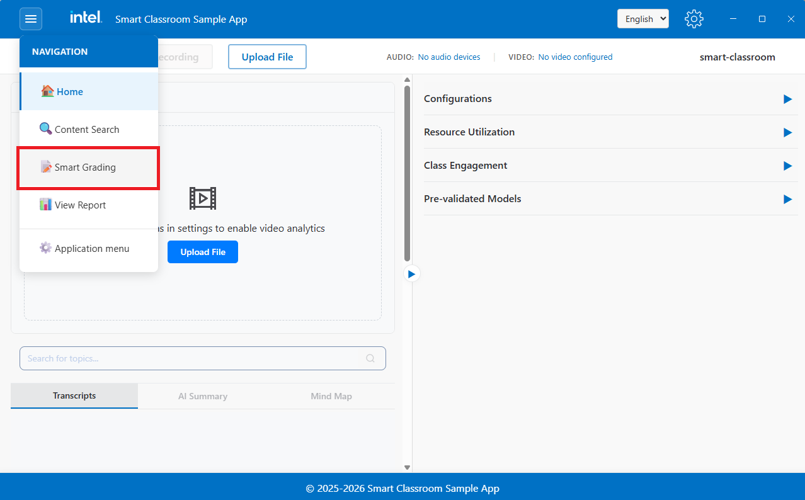
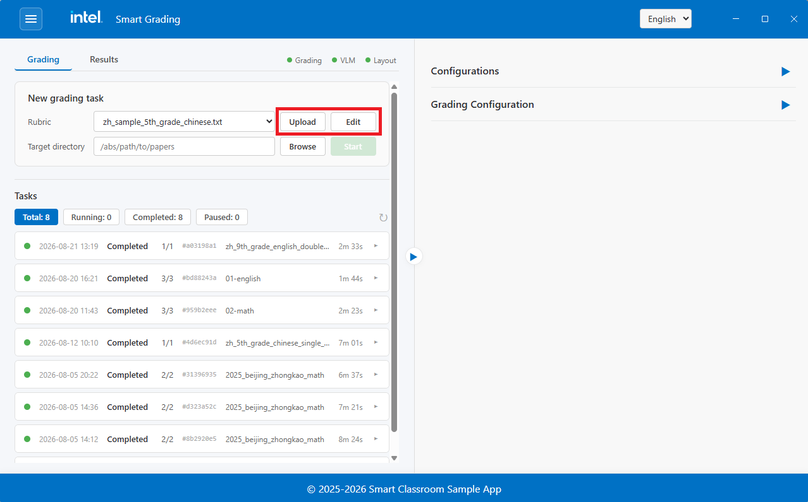
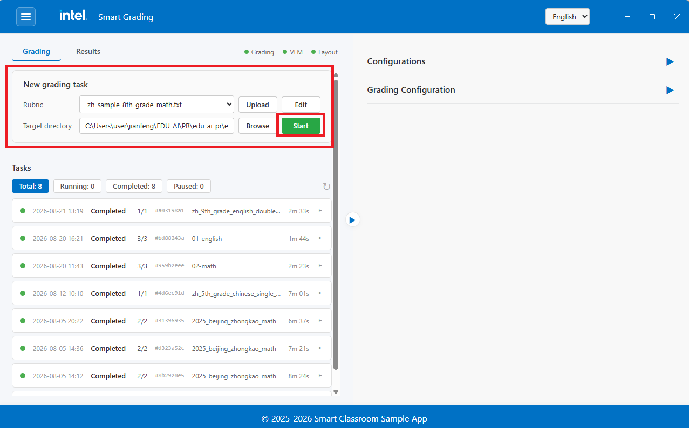
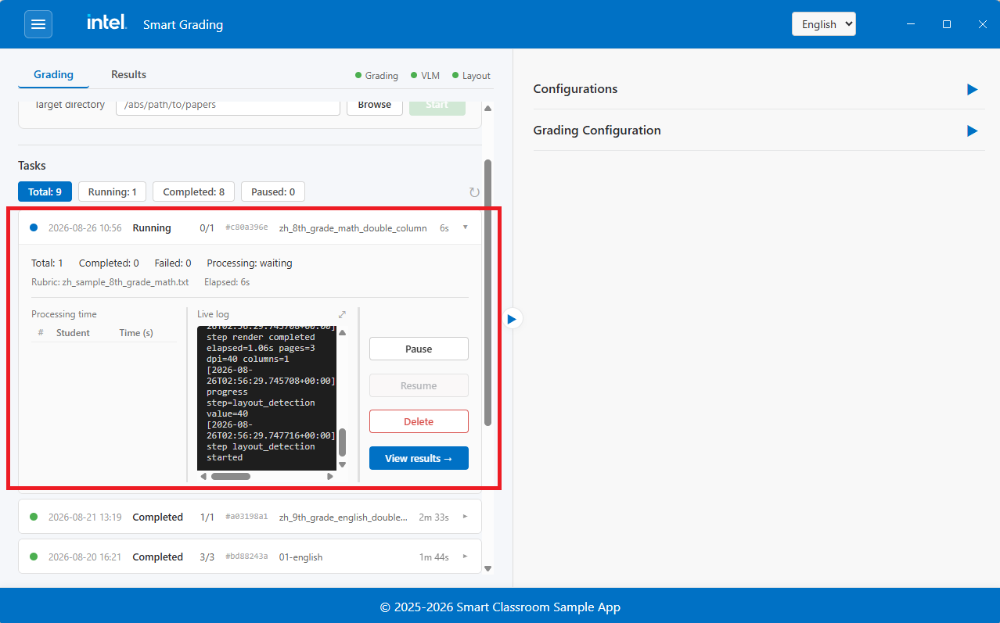
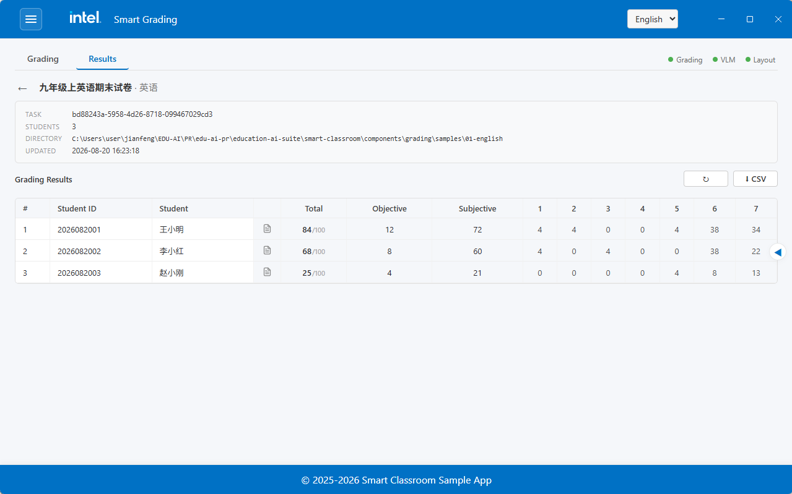

# Grading Flow

> [!IMPORTANT]
> **Language requirement:** Grading currently supports Chinese exam papers only. Before using the
  Grading feature, make sure the `language` setting in the main program's `config.yaml` is set to
  `zh`.

The Grading feature automatically scores scanned exam papers. You provide a paper (PDF) and a
rubric, and the system renders the pages, splits them into sections, and uses a Vision-Language
Model (VLM) to grade each section and produce a structured result with scores and reasoning.

To enter the Grading view, click the **Grading** button in the top navigation bar on the Smart
Classroom main screen:



## Step 1: Prepare a Rubric

A rubric tells the model how to grade. Upload one before creating a task:

1. Click **Upload Rubric** and select a `.txt` file.
2. The uploaded rubric appears in the rubric list and can be edited in place.



## Step 2: Create a Grading Task

1. Browse and select the exam paper (`.pdf`).
2. Select the rubric to grade against.
3. Click **Start Grading**.



The task runs through four steps automatically:

| Step | What happens |
| :--- | :--- |
| **Render** | The PDF is converted to page images. |
| **Layout detection** | Each page is analyzed to locate text, titles, tables, and formulas. |
| **Section split** | Pages are grouped into question sections, stitched across page breaks. |
| **VLM grading** | Each section image and its rubric are sent to the VLM, which returns scores and reasoning. |

## Step 3: Track Progress

The task list shows each task's status and progress. You can **pause**, **resume**, or **cancel**
a running task, and delete finished ones.



## Step 4: View Results

When a task completes, open it to see the graded result:

- **Score summary** - Objective, subjective, and total scores.
- **Per-question breakdown** - Each question's score, the student's answer, and the model's
  reasoning.



## Try a Built-in Sample

The repository ships with a set of ready-to-grade sample exams under
`components/grading/samples/` (a copy is provided for both the Linux and
Windows layouts). Use them to try the Grading feature end-to-end before you
prepare your own material.

### Included samples

| Subject | Layout | Paper | Rubric |
| :--- | :--- | :--- | :--- |
| Chinese | Single column | `exam/zh_5th_grade_chinese_single_column/scan_single_column.pdf` | `rubrics/zh_sample_5th_grade_chinese.txt` |
| Math | Double column | `exam/zh_8th_grade_math_double_column/student_1/scan_double_column.pdf` | `rubrics/zh_sample_8th_grade_math.txt` |
| English | Double column | `exam/zh_9th_grade_english_double_column/student_1/scan_double_column.pdf` | `rubrics/zh_sample_english_exam.txt` |
| Physics | Single column | `exam/zh_9th_grade_physics_single_column/student_1/scan_single_column.pdf` | `rubrics/zh_sample_physics_exam.txt` |

For example, to try the 5th-grade Chinese sample:

1. **Copy the rubric into the grading directory.** The rubric list is loaded
   only from the grading component's own `components/grading/rubrics/`
   directory (its root, not a subfolder). Copy the sample rubric there:

   ```bash
   cp components/grading/samples/rubrics/zh_sample_5th_grade_chinese.txt \
      components/grading/rubrics/
   ```

   It now appears in the **Upload Rubric** list.
2. **Create a task as described above**, and select:
   - **Rubric**: `zh_sample_5th_grade_chinese.txt` (from the rubric list)
   - **Paper**: `components/grading/samples/exam/zh_5th_grade_chinese_single_column/scan_single_column.pdf`

The page layout (single vs double column) is detected automatically — the
**Page Columns** setting defaults to **Auto**, so there is nothing to choose.
Leave it at **Auto**.

The paper is picked through the file picker, so navigate to the corresponding
PDF under `samples/exam/` when selecting it.

### Add your own sample

To run a rubric against your own material, follow the same convention:

1. **Copy the rubric file into `components/grading/rubrics/`** — the only
   location the system loads rubrics from *at its root*, not nested in a
   subfolder. Only `.txt` and `.json` files in that root directory are listed
   (`.json` files must be valid JSON). Follow the same sectioned rubric
   structure as the bundled samples: each question section carries a title
   header, an answer-key block, and a scoring-criteria block. The exact block
   labels are localized, so copy one of the bundled rubric files and edit it as
   a starting point rather than inventing new labels.
2. Select your scanned paper through the file picker when creating the task.

Page layout (single vs double column) is detected automatically by default
(`page_columns: auto` in `components/grading/config.yaml`). You only need to
override it if automatic detection is wrong for a particular paper — set
**Page Columns** to **1** or **2** in the grading panel.

## Models

| Model | Role | Device |
| :--- | :--- | :--- |
| PP-DocLayout | Page layout detection | NPU |
| PP-OCR | Read section titles | CPU |
| Qwen VLM | Grade sections | GPU |

## Learn More

- [Application Flow](./application-flow.md): End-to-end application flow.
- [How It Works](./how-it-works.md): Technical architecture and design details.
