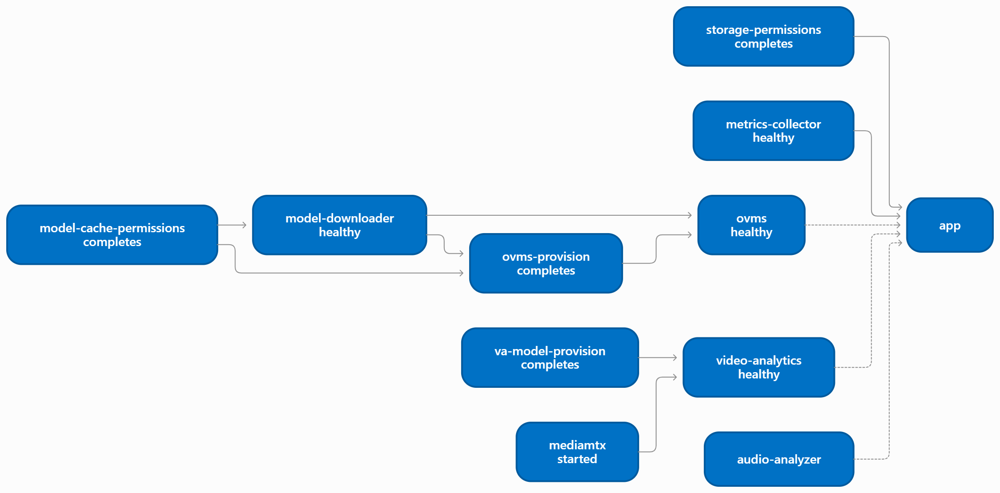
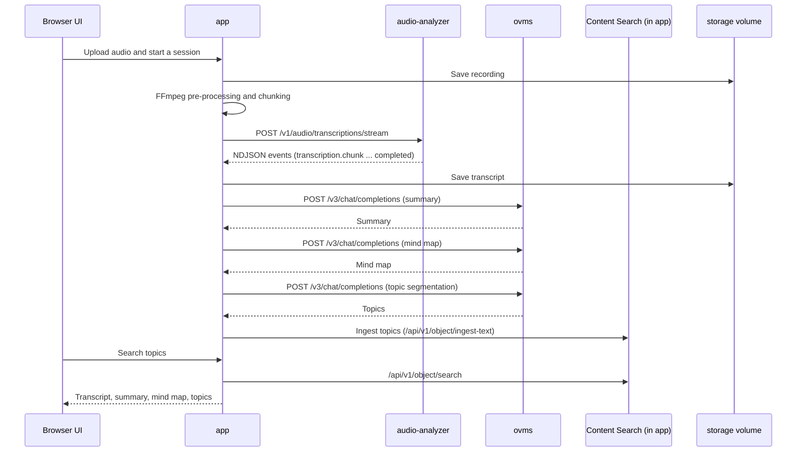
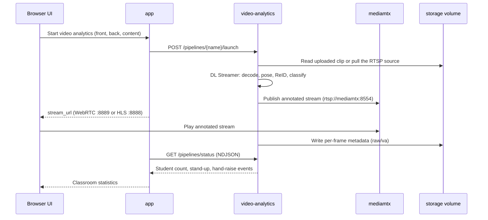
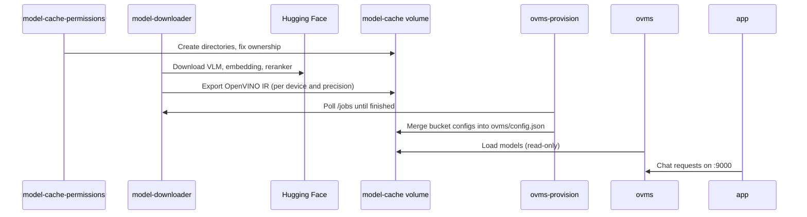

# Linux Docker Compose Architecture

On Linux, Smart Classroom runs as a set of containers managed by Docker Compose. This page shows which
containers belong to the Compose flow, what each one does, how they depend on each other, and how data
moves between them while a class is processed.

All paths in this page are relative to `smart-classroom/Linux`.

## Compose Files

`setup.sh` combines the following files into one Compose project named `smart-classroom`.

| File | Purpose | When it is used |
|---|---|---|
| `docker/docker-compose.yml` | Base file. Defines every service, volume, and the `smart-classroom` bridge network. | Always |
| `docker/docker-compose.gpu.yml` | Override that passes the Intel GPU (`/dev/dri`) and NPU (`/dev/accel`) into the accelerator-enabled services and swaps in the GPU model list. | Always on Linux. `setup.sh` adds it and sets `RENDER_GID`. |
| `docker/docker-compose.local-build.yml` | Override that builds `audio-analyzer`, `model-downloader`, and `metrics-collector` locally from the `edge-ai-libraries` and `performance-tools` submodules instead of pulling them from Docker Hub. | Only when `REGISTRY: false` in `config.yaml`. `setup.sh` adds it automatically. |

By default (`REGISTRY: true`), `audio-analyzer`, `model-downloader`, and `metrics-collector` use the Docker Hub
images shown in the service table. For the manual commands, see
[Manual Docker Startup](./get-started/get-started-linux.md#manual-docker-startup-optional).

The following images are always built locally:

| Image | Dockerfile |
|---|---|
| `smart-classroom-app:local` | `docker/app.Dockerfile` (builds the React UI, then the Python backend) |
| `sc-ovms-provision:local` | `docker/ovms-provision.Dockerfile` |
| `sc-video-analytics:local` | `video-analytics/docker/Dockerfile.va-pipeline` (based on `intel/dlstreamer`) |
| `sc-va-model-provision:local` | `video-analytics/docker/Dockerfile.va-provision` |

## Services in the Compose Flow

A service either belongs to the always-on core or to a Compose **profile**. Profiles are derived from the
`features:` block in `config.yaml` by `python3 -m utils.compose_profiles --write-env`, which `setup.sh`
runs for you and stores in `COMPOSE_PROFILES` in `.env`.

| Service | Container | Image | Profile | Type | Role |
|---|---|---|---|---|---|
| `app` | `smart-classroom-app` | `smart-classroom-app:local` | core | Long-running | The main backend. Serves the UI and the REST API, runs the audio pipeline, and hosts Content Search and Grading in-process. |
| `storage-permissions` | `sc-storage-permissions` | `python:3.12-slim` | core | One-shot | Creates `storage/smart-classroom` and `storage/content-search` and sets ownership for the `app` user (UID 10001). |
| `metrics-collector` | `sc-metrics-collector` | `intel/retail-benchmark` | core | Long-running | Telemetry sidecar for CPU, GPU, NPU, memory, and power. Serves `/metrics` and `/platform-info`. Runs privileged with read-only host `/sys` mounts. |
| `audio-analyzer` | `sc-audio-analyzer` | `intel/audio-analyzer` | `asr` | Long-running | Speech-to-text (Whisper or FunASR) and optional speaker diarization. |
| `model-cache-permissions` | `sc-model-cache-permissions` | `python:3.12-slim` | `text-gen` | One-shot | Prepares ownership and permissions on the shared `model-cache` volume. |
| `model-downloader` | `sc-model-downloader` | `intel/model-download` | `text-gen` | Long-running | Downloads and exports the VLM, embedding, and reranker models to OpenVINO™ IR, based on `startup-models*.yaml`. |
| `ovms-provision` | `sc-ovms-provision` | `sc-ovms-provision:local` | `text-gen` | One-shot | Waits for the downloader jobs to finish, then merges the exported models into `ovms/config.json`. |
| `ovms` | `sc-ovms` | `openvino/model_server:2026.4.1-gpu` | `text-gen` | Long-running | OpenVINO™ Model Server. Serves the text generation (VLM) model through an OpenAI-compatible API. |
| `va-model-provision` | `sc-va-model-provision` | `sc-va-model-provision:local` | `va` | One-shot | Exports the video analytics (YOLO pose and related) models to OpenVINO™ IR into the `video-analytics-models` volume. |
| `mediamtx` | `sc-mediamtx` | `bluenviron/mediamtx` | `va` | Long-running | Media server. Receives annotated RTSP streams from video analytics and relays them to the browser over WebRTC or HLS. |
| `video-analytics` | `sc-video-analytics` | `sc-video-analytics:local` | `va` | Long-running | DL Streamer pipeline engine for the front, back, and content camera pipelines. Control API on port 8020. |

> [!NOTE]
> Content Search (ChromaDB, file ingest, video preprocess, the search API) and Grading are **not** separate
> containers. The `app` container starts them as child processes, and they listen on loopback only.
> See [Services Inside the app Container](#services-inside-the-app-container).

### Features, Profiles, and Containers

| `config.yaml` feature | Profile(s) it activates | Containers that start in addition to the core |
|---|---|---|
| `asr` | `asr` | `audio-analyzer` |
| `summary`, `mindmap`, `topic_segmentation` | `asr`, `text-gen` | `audio-analyzer`, plus the `text-gen` group |
| `content_search`, `qa`, `grading` | `text-gen` | `model-cache-permissions`, `model-downloader`, `ovms-provision`, `ovms` |
| `video_analytics` | `va` | `va-model-provision`, `mediamtx`, `video-analytics` |

The resulting container set for each profile (verified with `docker compose config --services`):

| `COMPOSE_PROFILES` | Containers that run |
|---|---|
| *(empty)* | `storage-permissions`, `metrics-collector`, `app` |
| `asr` | core + `audio-analyzer` |
| `text-gen` | core + `model-cache-permissions`, `model-downloader`, `ovms-provision`, `ovms` |
| `va` | core + `va-model-provision`, `mediamtx`, `video-analytics` |
| `asr,text-gen,va` (all default features on) | All 11 services |

> [!IMPORTANT]
> After you change `features:` in `config.yaml`, rerun `./setup.sh` so that `COMPOSE_PROFILES` is regenerated.
> A service whose profile is not active is not created at all.

## Architecture Overview

### Services Inside the app Container

The `app` container runs these processes. Content Search and Grading start only when the matching feature is
enabled. Except for the FastAPI backend on port 8000, they are not Compose services and are not published to the
host.

| Process | Port (loopback) | Started by | Purpose |
|---|---|---|---|
| FastAPI backend | 8000 | Image `CMD` (`uvicorn main:app`) | UI, session API, audio pipeline, reverse proxy. Published to the host. |
| Content Search API | 9011 | `ContentSearchFeature` | Search, ingest, and Q&A |
| ChromaDB | 9090 | `content_search/start_services.py` | Vector database |
| File ingest and retrieve | 9990 | `content_search/start_services.py` | Document and media embedding, reranking (reranker on GPU) |
| Video preprocess | 8001 | `content_search/start_services.py` | Video chunking and summarization with the VLM |
| Grading API | 9012 | `GradingFeature` | Assignment grading |

The browser reaches Content Search and Grading through the `app` reverse proxy on port 8000
(`/api/v1/object`, `/api/v1/task`, `/api/v1/system`, and `/grading-api`).

### Published Ports

Only these ports are reachable from the host. Everything else stays on the internal Docker network.

| Host port | Container | Purpose |
|---|---|---|
| `8000` | `app:8000` | Web UI, REST API, and same-origin proxy to Content Search, Grading, and the audio-analyzer WebSocket |
| `9100` | `metrics-collector:9000` | Manual check of `/metrics` with `curl http://localhost:9100/metrics` |
| `8200` | `model-downloader:8000` | Model downloader API |
| `8554` | `mediamtx:8554` | RTSP publish and read |
| `8888` | `mediamtx:8888` | HLS playback in the browser |
| `8889` | `mediamtx:8889` | WebRTC signaling and playback in the browser |
| `8189/udp` | `mediamtx:8189` | WebRTC ICE |
| `5173` | Host process | Vite dev server for the UI, started by `setup.sh` (not part of Compose) |

The MediaMTX ports can be changed with `VA_MEDIAMTX_RTSP_PORT`, `VA_MEDIAMTX_HLS_PORT`,
`VA_MEDIAMTX_WEBRTC_PORT`, and `VA_MEDIAMTX_WEBRTC_ICE_PORT` in `.env`.

### Internal-Only Endpoints

| Service | Address used by `app` | Environment variable |
|---|---|---|
| `audio-analyzer` | `http://audio-analyzer:8010` | `AUDIO_ANALYZER_URL` |
| `ovms` | `http://ovms:9000` | `SERVING_BASE_URL` |
| `video-analytics` | `http://video-analytics:8020` | `VIDEO_ANALYTICS_URL` |
| `metrics-collector` | `http://metrics-collector:9000` | `METRICS_COLLECTOR_URL` |


## Volumes and Shared Storage

| Volume or mount | Used by | Contents |
|---|---|---|
| `${STORAGE_DIR:-../storage}` (bind mount, default `Linux/storage`) | `app` (read and write), `video-analytics`, `storage-permissions` | Session data under `smart-classroom/`, Content Search data (SQLite, ChromaDB, uploads) under `content-search/`, and the GStreamer cache under `gstreamer/` |
| `model-cache` | `model-cache-permissions`, `model-downloader`, `ovms-provision` (read and write); `ovms` (read-only); `app` (mounted at `/app/models`) | OVMS model repository (`ovms/openvino_models`, `ovms/config.json`) and the models that Content Search converts on first use |
| `video-analytics-models` | `va-model-provision` (read and write), `video-analytics` (read-only) | Exported video analytics OpenVINO™ models |
| `audio-analyzer-models`, `-chunks`, `-storage`, `-cache` | `audio-analyzer` | Downloaded ASR and diarization models, audio chunks, and caches. Models persist, so later starts are fast. |
| `metrics` | `metrics-collector` | Telemetry results, such as NPU usage CSV |
| `components/vlm/config/startup-models.yaml` (bind mount) | `model-downloader`, `ovms-provision` | List of models to export. The GPU override mounts `startup-models.gpu.yaml` instead. |
| `edge-ai-libraries/microservices/audio-analyzer/config.yaml` (bind mount) | `audio-analyzer` | ASR provider, model, device, and diarization settings |

## Startup Order and Health

Compose enforces the following dependencies. Solid arrows are hard dependencies. The dotted arrows are soft
dependencies, which the application handles at runtime and Compose does not enforce.



`app` waits only for `storage-permissions` and `metrics-collector`. It does not wait for `ovms`,
`audio-analyzer`, or `video-analytics`, because those belong to optional profiles. The `app` container calls
them only when the matching feature is used.

| Service | Health check | Notes |
|---|---|---|
| `app` | `GET :8000/health` | `setup.sh` waits for this to become `healthy`, then for Content Search readiness at `/api/v1/system/health`. |
| `metrics-collector` | `GET :9000/health` | |
| `audio-analyzer` | `GET :8010/health` | The port opens only after models are preloaded, which includes the first-run download. |
| `model-downloader` | `GET :8000/health` | The first run exports the VLM, embedding, and reranker models. |
| `ovms` | `GET :9000/v2/health/ready` | Starts after the models and `config.json` exist. |
| `video-analytics` | `GET :8020/health` | |

> [!NOTE]
> The first run can take up to about 30 minutes while models download and export. Later runs reuse the
> cached volumes.

## Runtime Flows

### Audio Pipeline



- **Transcription** runs out of process in `audio-analyzer`. The provider (`openvino`, `funasr`, or `openai`)
  comes from `models.asr.provider` in `config.yaml`.
- **Summary, mind map, and topic segmentation** use the VLM in `ovms` (`models.text_gen`). Long transcripts are
  chunked to fit the prompt budget.
- **Live microphone** audio streams from the browser to `audio-analyzer` through a WebSocket proxy in `app`.

### Video Analytics Pipeline



- `video-analytics` runs the `front`, `back`, and `content` pipelines on the device set by `VA_*_DEVICE`
  (default `NPU`). RTSP sources are decoded on the GPU, so `/dev/dri` is needed unless every source is a file.
- The browser plays the annotated stream directly from `mediamtx`, which is why its ports are published.
  Inter-container RTSP bypasses any corporate proxy through `NO_PROXY`.

### Model Provisioning for `text-gen`



The model list comes from `components/vlm/config/startup-models.yaml` (or `startup-models.gpu.yaml` with the GPU
override). `setup.sh` keeps both files in sync with `models.text_gen`, `models.embedding`, and the Content
Search reranker in `config.yaml`.

### Telemetry

The `app` container polls `metrics-collector` for `/metrics` and `/platform-info`. The UI shows these as
live CPU, GPU, NPU, memory, and power utilization. The collector needs `privileged: true` and read-only access
to the host `/sys` to read hardware counters.

## GPU and NPU Passthrough

`docker-compose.gpu.yml` adds `/dev/dri` and the `render` group (`RENDER_GID`) to these services:

| Service | Devices | Used for |
|---|---|---|
| `app` | `/dev/dri` (in the base file) | Content Search reranking |
| `ovms` | `/dev/dri` | VLM inference |
| `model-downloader` | `/dev/dri` | Model export and the GPU model list |
| `audio-analyzer` | `/dev/dri`, `/dev/accel` | Whisper or diarization when the configured device is not `CPU` |
| `video-analytics` | `/dev/dri`, `/dev/accel` | VA-API decode and encode, and pose, ReID, and classification on GPU or NPU |
| `metrics-collector` | `/dev/dri`, `/dev/accel` | GPU and NPU utilization |

## Environment Variables

`setup.sh` creates `.env` from `.env.example`. The main variables are:

| Variable | Purpose |
|---|---|
| `COMPOSE_PROFILES` | Active profiles (`asr`, `text-gen`, `va`). Generated from `config.yaml`. |
| `COMPOSE_PROJECT_NAME` | Compose project name (`smart-classroom`). |
| `RENDER_GID` | Host `render` group ID. Required. Set by `setup.sh`. |
| `STORAGE_DIR` | Host path for the shared storage bind mount. Defaults to `Linux/storage`. |
| `HF_TOKEN` | Hugging Face token for diarization and gated models. |
| `INTEL_IMAGE_TAG` | Tag for `intel/model-download` and `intel/retail-benchmark`. |
| `OVMS_RELEASE_TAG` | OVMS release the downloader uses. Keep it aligned with the `ovms` image tag. |
| `ENABLED_PLUGINS` | Model downloader plugins. Defaults to `huggingface,openvino`. |
| `HTTP_PROXY`, `HTTPS_PROXY`, `NO_PROXY` | Proxy settings forwarded to builds and containers. |
| `CORPORATE_CA_FILE` | Optional PEM file for TLS-inspecting corporate proxies. Used only at build time. |
| `VA_*` | Video analytics device, codec, pose-tuning, and MediaMTX port settings. |

## Common Commands

Run these from `smart-classroom/Linux`.

```bash
# List the services and their health
docker compose -f docker/docker-compose.yml -f docker/docker-compose.gpu.yml ps

# Show which services the current COMPOSE_PROFILES will start
docker compose --env-file .env -f docker/docker-compose.yml -f docker/docker-compose.gpu.yml config --services

# Follow logs for one or more services
docker compose -f docker/docker-compose.yml -f docker/docker-compose.gpu.yml logs -f app
docker compose -f docker/docker-compose.yml -f docker/docker-compose.gpu.yml logs -f model-downloader ovms

# Stop the stack
docker compose -f docker/docker-compose.yml -f docker/docker-compose.gpu.yml down
```

> [!NOTE]
> Include the same `-f` files that `setup.sh` uses. Otherwise Compose does not see the GPU override and
> `RENDER_GID` is not applied consistently. When `REGISTRY: false`, also add
> `-f docker/docker-compose.local-build.yml`.

## Learn More

- [Get Started on Linux](./get-started/get-started-linux.md): Run `setup.sh` and verify the stack.
- [Manual Docker Startup (Optional)](./get-started/get-started-linux.md#manual-docker-startup-optional): Run the Compose commands yourself instead of `setup.sh`.
- [Content Search Flow](./content-search-flow.md): The Content Search feature in the UI.
